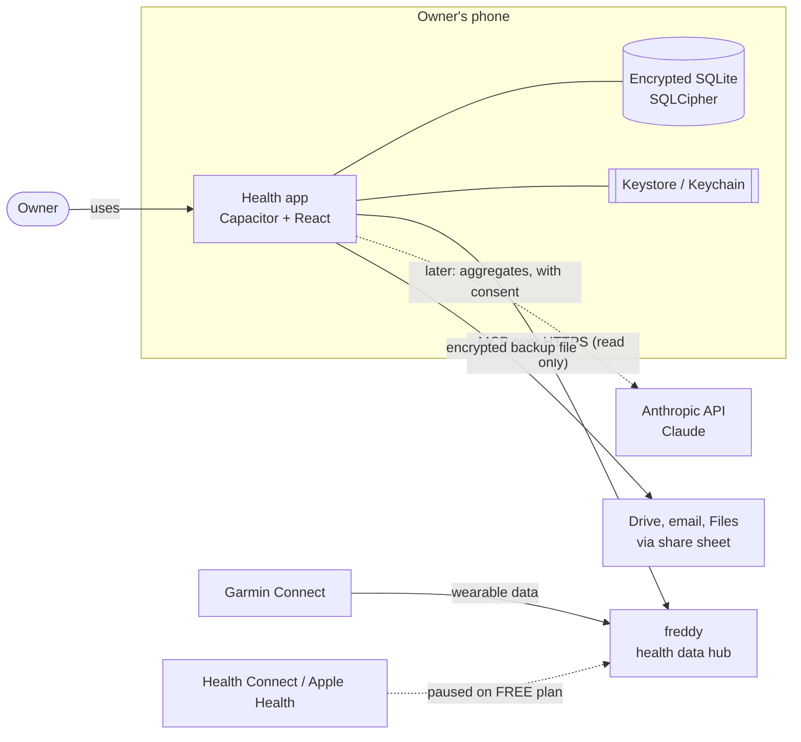
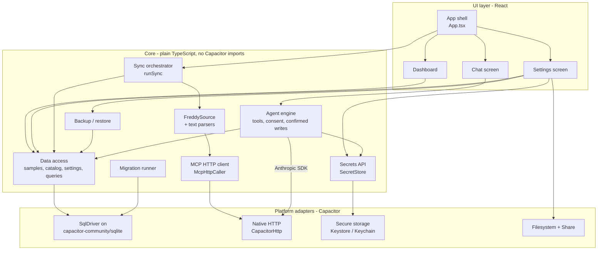
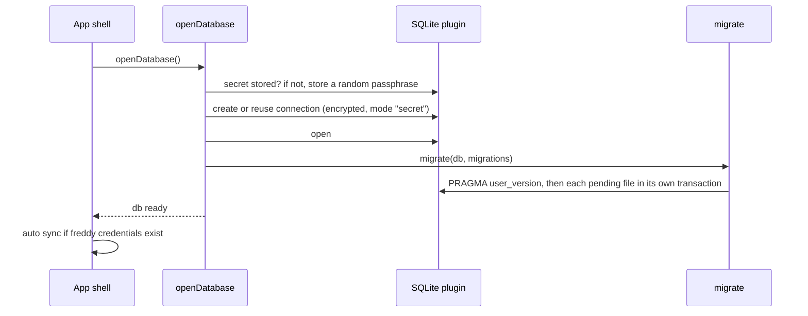
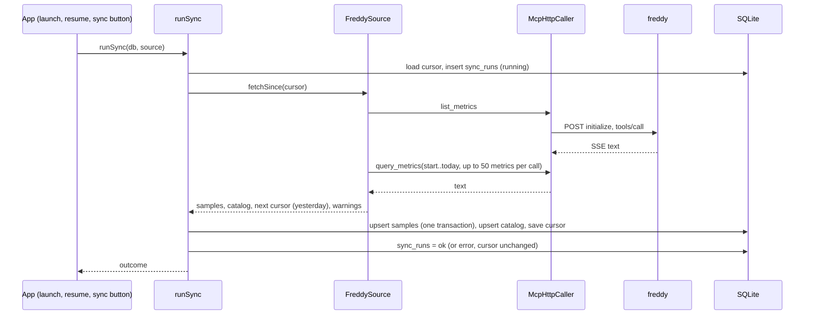
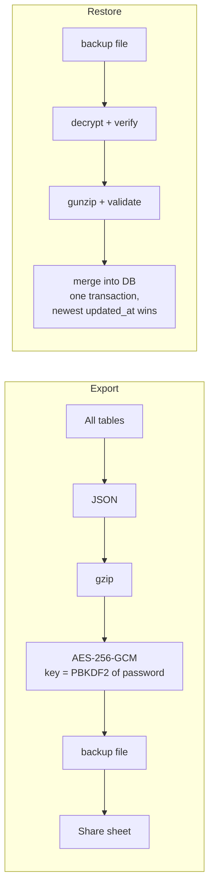
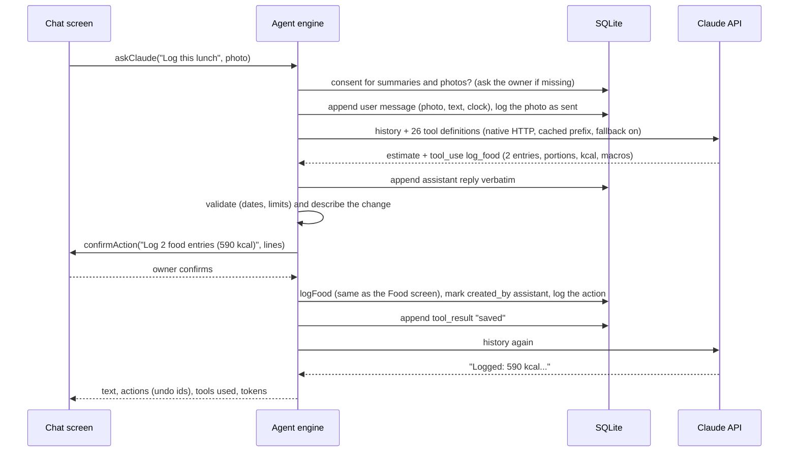

# Health App: High-Level Design (HLD)

Status as of 25 Oct 2026, phase 1. This document shows the system as a whole: its context, its main components, how data flows between them, and the security and quality properties it is built to have. The reasons behind each choice are in [architecture.md](architecture.md); module-level detail is in [LLD.md](LLD.md).

## 1. Goals and scope

**Goals (phase 1)**
- Mirror the owner's wearable data (Garmin today, via freddy) into a local, encrypted database on their phone, and keep it beyond freddy's 7-day free-plan window.
- Show daily values and trends, and record what wearables do not capture: food, alcohol, manual measurements, daily notes, goals.
- Later in phase 1: let the owner ask Claude about their data, with consent and a record of what was sent.

**Non-goals (phase 1)**
- No server, no account, no multi-user support.
- No direct integration with Garmin, HealthKit or Health Connect (freddy does that).
- No medical diagnosis.

**Constraints**
- One developer, personal scale (a few million rows a year at most).
- freddy FREE plan: 7 days of history, 1 source, text-only MCP tools.
- Health data is GDPR special-category data.

## 2. System context

| External system | Role | Direction | Data |
|---|---|---|---|
| freddy | Single source of wearable data | App reads | Daily metrics as text through MCP tools (`list_metrics`, `query_metrics`) |
| Anthropic API | The agent: answers questions, estimates meals from photos, plans meal prep (core built) | App sends, receives | Aggregates by default; detailed records, notes and photos only with consent |
| Share targets | Where the owner keeps backups | App sends | One password-encrypted file |

## 3. Components

| Component | Responsibility | Main files |
|---|---|---|
| App shell | Opens the DB, runs migrations, triggers sync on launch, the five tabs in a bottom bar (Dashboard, Chat, Meal prep, Alcohol, Settings) | `src/app/App.tsx`, `src/app/TabBar.tsx`, `src/platform/openDatabase.ts` |
| Dashboard tab | A greeting with the profile picture (opens the profile) and sync; quick actions (log food or a drink, ask Claude, the check-in); Day / Week / Month with rings for calories eaten against the target and steps against the goal, burned, balance and protein; the check-in and latest weight; energy, workouts and meal prep as the day's numbers or daily averages and totals; charts per day; every synced number of a day | `src/features/dashboard/` |
| Journal (from the Dashboard) | Daily check-in (mood and energy 1 to 5, a note) with 30 days of history and a trend; manual measurements (weight, body fat, waist, blood pressure, resting heart rate, glucose, supplements, symptoms) with a trend per kind | `src/features/journal/` |
| Chat tab | Conversations with Claude: camera or gallery photos, quick prompts, consent and change confirmation in line, changes with undo, history | `src/features/chat/ui/ChatScreen.tsx` |
| Meal prep tab | Two groups: *Food log* (today, history, saved meals) and *Meal prep* (stock and defrost plan, recipes, shopping list) | `src/features/mealprep/ui/`, `src/features/food/ui/` |
| UI kit and palette | Shared components (charts, figures, controls, `PageHeader`, `SubTabs`, `Segmented`, `Icon`) and the one color palette (`palette.css`), checked by tests. Screens: `docs/screens/index.html` | `src/ui/` |
| Alcohol tab | One-tap drink logging first, then drinks per period, their kcal and cost, weight without alcohol | `src/features/alcohol/ui/` |
| Settings tab | A menu in three groups (You, Data, App) opening each page with a way back. *Profile*: Google account, owner profile (birth date, sex, height, activity, weight goal) and the estimates it allows. *Connections*: freddy, Claude API key, Garmin history. *Privacy & data*: Claude consents, what was sent, what is stored, backup and restore. *Debug logs*: the Logs screen. *About*: version, build, platform, schema | `src/features/settings/` |
| Profile (from the Dashboard) | past activity imported and synced, picture, name and body numbers, the owner's sports, goals with progress (add from templates, delete), workouts: totals per sport, longest sessions, recent sessions | `src/features/me/` |
| Debug logs (Settings) | log level, this run's records, export as a Markdown report for Claude (file or text), clear | `src/features/logs/` |
| Sync orchestrator | One sync of one source: fetch, store, move the cursor, log the attempt | `src/features/sync/runSync.ts` |
| FreddySource | Decides the date window, discovers metrics, calls tools, parses text into samples | `src/features/sync/freddy.ts`, `src/features/sync/freddyText.ts` |
| MCP HTTP client | JSON-RPC over HTTP with SSE replies, only CORS-safe headers, no secrets in errors | `src/features/sync/mcpHttp.ts` |
| Native HTTP adapter | `fetch` look-alike over `CapacitorHttp` | `src/platform/nativeFetch.ts` |
| Data access | Per feature: samples, catalog, day queries, food, meal prep, shopping, journal. Shared: settings, transactions | `src/features/*/*.ts`, `src/db/settings.ts`, `src/db/tx.ts` |
| Migration runner | Applies numbered SQL files, versioned in `PRAGMA user_version` | `src/db/migrate.ts`, `src/db/migrations/` |
| Logging | Scoped, levelled logger; console and an in-memory buffer; secrets redacted; level stored in settings | `src/core/log.ts`, `src/app/logging.ts`, `src/features/settings/logLevel.ts` |
| SqlDriver (Capacitor) | Adapts the SQLite plugin to a 3-method interface and hides its quirks | `src/platform/sqlite.ts` |
| Backup | Export every table to an encrypted file; restore by merging | `src/features/backup/` |
| Secrets | freddy URL and key, Claude API key | `src/features/settings/` |
| Alcohol counter | Drink types with price and kcal, drink log, totals in kcal and money, expected weight without alcohol | `src/features/alcohol/` |
| Agent engine | Tool-use loop with Claude: read tools with consent per data class, confirmed write tools (through `food.ts`, `mealPrep.ts`, `shopping.ts`, `logs.ts`) with undo, photos, disclosure log, conversation store | `src/features/chat/` |

**Code layout:** `app/` (shell), `features/<name>/` (logic, data access and screens per feature), `ui/`, `platform/` (every Capacitor adapter), `db/`, `core/` (pure helpers). See [LLD section 1](LLD.md#1-repository-layout) and the rules in [architecture.md section 3](architecture.md#3-rules-the-code-must-keep).

**Design principle:** everything in "Core" depends only on interfaces (`SqlDriver`, `Source`, `ToolCaller`, `SecretStore`, a `fetch` function). Only the platform adapters import Capacitor. That is why the whole core runs in Node tests and in PC scripts (`scripts/freddy-sync.ts`) without a phone.

## 4. Main flows

### 4.1 App start

The browser build (`npm run dev`) stops at the first step: the local database exists only in the native app.

### 4.2 Sync

Key properties:
- **Idempotent:** samples are keyed by (source, device, metric, external_id), so re-reading a day updates rows in place.
- **Self-healing window:** the next cursor is yesterday, because today (and sometimes yesterday) are incomplete when read.
- **Visible gaps:** if the last cursor is older than the plan's window, a "Gap" warning names the days that could not be fetched.
- **Never throws to the UI:** failures are stored in `sync_runs` and `sync_state.last_error`; concurrent triggers share one run.

### 4.3 Backup and restore

### 4.4 Claude agent

Example: the owner sends a photo of lunch and asks to log it.

Reads work the same way without the confirmation: each read tool needs the consent for its data class (summaries, detailed records, notes), and every result sent is logged in `ai_disclosures`. A tool without consent is not run, and Claude is told to answer without it. Only tool results and attached photos leave the phone, never the database.

The agent writes through the same functions as the Food and Meal prep screens, so its entries, recipes, batches and shopping lines behave like the owner's. What it can change is limited in code: additive only, hard input limits, owner confirmation for every change, a log of every proposal, and an undo for each saved one. See [architecture.md section 5](architecture.md#5-claude-integration-phase-1) and [LLD.md section 9b.7](LLD.md#9b7-write-tools-security-model-undo).

## 5. Data

One local SQLite database (`health`), encrypted with SQLCipher. Main groups:

| Group | Tables | Written by |
|---|---|---|
| Synced data | `health_samples`, `metric_catalog`, `sync_state`, `sync_runs` | Sync |
| Logs written by the owner | `food_entries`, `drink_entries`, `manual_measurements`, `day_notes`, `goals` | UI (Meal prep, Alcohol, Journal, profile) and the agent |
| Claude | `chat_conversations`, `chat_messages`, `ai_disclosures`, `consents`, `agent_actions` | Agent engine (Chat tab) |
| Settings | `app_settings` (non-secret) | UI |
| Read models | Views `daily_metric_values`, `daily_nutrition`, `daily_alcohol` | Derived |

Full columns and constraints: [LLD.md section 4](LLD.md#4-schema).

## 6. Security and privacy

| Asset | Protection |
|---|---|
| Database at rest | SQLCipher. Random 32-byte passphrase per install, kept by the SQLite plugin in Keystore-backed storage (Android) / Keychain (iOS) |
| freddy URL and key, future Claude key | Keystore / Keychain via secure storage. Never in SQLite, so never in a backup. Memory only in the browser build |
| Data in transit | HTTPS only (the URL validator rejects `http://`) |
| Backup files | AES-256-GCM with a key derived from the owner's password (PBKDF2-SHA256, 600k iterations). The header is authenticated, so any edit makes the file unreadable |
| OS backups | Android auto-backup, adb backup and device-to-device transfer disabled |
| Logs and errors | Network errors never include the URL or key. Scripts print counts, not health values |
| Data sent to Claude | Explicit consent per data class (summaries, detailed records, notes, photos) with a policy version; tools without consent are not run; every payload and photo logged in `ai_disclosures` |
| Changes made by the agent | Additive only, through the app's own functions; validated; confirmed by the owner line by line; logged in `agent_actions`; undo per action with the app's own undo. Injected instructions (in photos or notes) can at most propose a change the owner must confirm |
| Who owns the data | Optional Google sign-in binds the phone's data to one account (its stable id, no token stored); another account cannot see or restore into it. Not a lock: SQLCipher protects the data either way |

Threats not covered in phase 1: a rooted or unlocked phone in an attacker's hands while the app is open, and a weak backup password chosen by the owner (minimum length 8 is enforced).

## 7. Deployment

| Target | How | Status |
|---|---|---|
| Android (S23) | `npm run android:sync` (build, `cap sync`, hardening script), then build and run from Android Studio | Not yet run on the device |
| iOS (iPhone 14) | Same code; `npx cap add ios` on a Mac | Not started |
| Browser | `npm run dev`, UI only, no database | Development aid |
| PC scripts | `scripts/freddy-sync.ts` (real freddy -> SQLite file), `scripts/garmin-import.ts` (Garmin account export -> encrypted backup to restore on the phone), `scripts/freddy-probe.mjs` | In use |

Native projects are generated and git-ignored; the repo holds only the web code, the Capacitor config and the patch scripts.

## 8. Quality attributes

| Attribute | How it is met |
|---|---|
| Offline first | Everything except sync and chat works without network |
| Data durability | Idempotent upserts; one transaction per migration, per sync batch and per restore; encrypted backups |
| Testability | Core depends on interfaces; 175 Node tests, including a fake of the Android plugin's statement splitting and transactions |
| Replaceable source | `Source` and `ToolCaller` interfaces; MCP today, REST later, others possible |
| Phase 2 readiness | UUIDv7 keys, `updated_at` / `deleted_at` / `origin_device_id` on user tables, append-only samples |
| Performance | Personal scale. Indexed by (metric, local_day). Restore inserts in multi-row batches to limit bridge calls |

## 9. Phase 2 outlook

A Node + Postgres server would receive samples by cursor sync and user tables by last-write-wins on `updated_at`; a web app would read the same API. The Claude key would move behind a server proxy. None of this changes the phone schema rules. See [architecture.md section 6](architecture.md#6-phase-2-parking-lot-noted-not-built).
