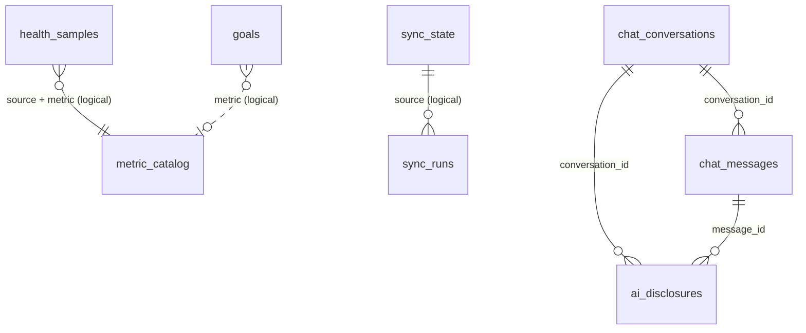

# Health App: Low-Level Design (LLD)

Status as of 25 Oct 2026, phase 1, schema version 2. This document describes the code: modules, interfaces, the full schema, the algorithms and file formats, error handling and tests. It assumes you have read [HLD.md](HLD.md). Reasons for decisions are in [architecture.md](architecture.md).

## 1. Repository layout

```
src/
  App.tsx, main.tsx, styles.css   App shell (DB open, auto sync, tabs)
  screens/                        TodayScreen, SettingsScreen
  db/
    driver.ts                     SqlDriver interface
    capacitorDriver.ts            SqlDriver on @capacitor-community/sqlite
    open.ts                       openDatabase(): encryption, connection, migrate
    migrate.ts                    parseMigrations(), migrate()
    migrations.ts                 Vite import of migrations/*.sql
    migrations/0001_init.sql      base tables
    migrations/0002_daily_data.sql
    samples.ts                    upsertSamples, sync_state cursor
    catalog.ts                    metric_catalog upsert, classifyMetric
    settings.ts                   app_settings get/set, deviceId
    queries.ts                    read models for screens
  sources/
    types.ts                      Source, SampleInput, SyncResult, CatalogEntry
    freddy.ts                     FreddySource, ToolCaller, metric filter
    freddyText.ts                 parsers for freddy's text output
    mcpHttp.ts                    McpHttpCaller (MCP over HTTP + SSE)
    nativeFetch.ts                fetch look-alike over CapacitorHttp
  sync/
    runSync.ts                    runSync, lastSync
    freddyClient.ts               builds a FreddySource from settings
  backup/
    backup.ts                     exportBackup, restoreBackup, BACKUP_TABLES
    files.ts                      share sheet / download
  chat/
    engine.ts                     startConversation, askClaude, continueConversation (tool-use loop)
    tools.ts                      the 8 local data tools and their data classes
    consent.ts                    per-class consent (GDPR)
    store.ts                      conversations, messages, disclosures
    prompt.ts                     system prompt, date block
    client.ts                     Anthropic SDK client (custom fetch)
    service.ts                    phone wiring: key, native HTTP, device id, effort
  settings/
    secrets.ts                    SecretStore, freddy credentials
    secureStore.ts                Keystore-backed SecretStore
  lib/
    tz.ts                         timezone helpers (Intl, no library)
    uuidv7.ts                     UUIDv7 generator
tests/                            node:test suites, fixtures, fakes
scripts/                          probe, PC sync, Drizzle spike, Android hardening
docs/                             this documentation
capacitor.config.json             app id, SQLite encryption settings
```

Dependency rule: nothing under `db/` (except `open.ts`), `sources/`, `sync/` (except the types it imports), `backup/backup.ts`, `settings/secrets.ts` or `lib/` imports Capacitor at runtime. Those modules run in Node.

## 2. Core interfaces

```ts
// src/db/driver.ts
type SqlValue = string | number | null;
interface SqlDriver {
  exec(sql: string): Promise<void>;                                   // no params, no result, may be several statements
  run(sql: string, params?: SqlValue[]): Promise<void>;                // one parameterised statement
  all<T>(sql: string, params?: SqlValue[]): Promise<T[]>;             // rows as objects keyed by column name
}

// src/sources/types.ts
interface Source {
  readonly id: string;                                                 // "freddy"
  fetchSince(cursor: string | null): Promise<SyncResult>;
}
interface SyncResult {
  samples: SampleInput[];
  catalog?: CatalogEntry[];                                            // when the source listed its metrics
  nextCursor: string | null;                                           // opaque, stored in sync_state
  warnings?: string[];
}
interface SampleInput {
  source: string; device: string; externalId: string; metric: string;
  startMs: number; endMs?: number; offsetMin: number;
  valueNum?: number; valueText?: string; unit?: string; raw?: unknown;
}

// src/sources/freddy.ts
interface ToolCaller { callTool(name: string, args: Record<string, unknown>): Promise<string>; }

// src/settings/secrets.ts
interface SecretStore {
  get(key: string): Promise<string | null>;
  set(key: string, value: string): Promise<void>;
  remove(key: string): Promise<void>;
}
```

Implementations:

| Interface | Phone | Tests / PC |
|---|---|---|
| `SqlDriver` | `capacitorDriver(conn)` | `memoryDriver()` on `node:sqlite` (`tests/helpers.ts`); `capacitorDriver(fakePlugin().conn)` (`tests/fakePlugin.ts`); file DB in `scripts/freddy-sync.ts` |
| `ToolCaller` | `McpHttpCaller` with native fetch | `McpHttpCaller` with a fake fetch; plain fake callers |
| `SecretStore` | `secretStore` (Keystore/Keychain) | `memorySecretStore()` (also used by the browser build) |

## 3. Database access

### 3.1 Opening (`src/db/open.ts`)

1. Refuse on non-native platforms (`Capacitor.isNativePlatform()`), with the message the shell shows.
2. If `isSecretStored()` is false, `setEncryptionSecret(hex of 32 random bytes)`. The plugin keeps it in its secure store.
3. `checkConnectionsConsistency()` + `isConnection("health")`: reuse the native connection after a WebView reload, otherwise `createConnection("health", encrypted=true, mode="secret", version=1, readonly=false)`.
4. `open()` if not open. The plugin enables foreign keys on open.
5. `migrate(capacitorDriver(conn), migrations)`.

`openDatabase()` caches its in-flight promise, because React StrictMode runs effects twice and two concurrent `createConnection` calls for one name fail. A failed open is not cached, so it can be retried.

The plugin's own version system is not used: with `version=1` and no `addUpgradeStatement`, it never touches `PRAGMA user_version`, so `migrate()` owns it.

Config (`capacitor.config.json`): `androidIsEncryption: true`, `iosIsEncryption: true`, `iosKeychainPrefix: "app.health.personal"`, biometrics off.

### 3.2 Capacitor driver (`src/db/capacitorDriver.ts`)

It depends only on `PluginConnection = Pick<SQLiteDBConnection, "execute" | "run" | "query" | "beginTransaction" | "commitTransaction" | "rollbackTransaction">`.

| Plugin behaviour | What the driver does |
|---|---|
| `execute()` and `run()` wrap each call in their own transaction unless passed `false` | Always passes `transaction=false`. `exec("BEGIN" / "COMMIT" / "END" / "ROLLBACK" [TRANSACTION])` maps to `beginTransaction` / `commitTransaction` / `rollbackTransaction`, so callers control transactions as on any SQLite |
| Android `execute()` splits the script on `";\n"`, strips `--` comments line by line, and runs each piece as a single statement | Normalises `\r\n` and `\r` to `\n` first. Without that, a CRLF file becomes one piece and only its first statement runs, with no error |
| iOS `query()` may return a first row `{ ios_columns: [...] }` | Drops it |
| `run()` has a `returnMode` | Passes `"no"` |

Consequences for SQL written for this app: no semicolons inside comments in multi-statement scripts, no `--` inside string literals in migration files, and no triggers (the plugin's trigger handling is not tested).

### 3.3 Migrations (`src/db/migrate.ts`)

- Files: `src/db/migrations/NNNN_name.sql`, inlined by Vite (`import.meta.glob(..., { query: "?raw", eager: true })`), read from disk in tests and scripts.
- `parseMigrations(files)`: parses the version from the file name, sorts, rejects bad names and duplicate versions.
- `migrate(db, migrations)`: reads `PRAGMA user_version`; for each newer migration runs `BEGIN`, the file, `PRAGMA user_version = N`, `COMMIT`. On error: `ROLLBACK` and throw `Migration N_name failed: ...`. The DB stays at the last good version. Returns the versions applied.

### 3.4 Write helpers

| Function | SQL behaviour |
|---|---|
| `upsertSamples(db, samples, nowMs, newId)` | One transaction. `INSERT ... ON CONFLICT (source, device, metric, external_id) DO UPDATE` of times, values, unit, raw, `local_day`, `updated_at`. The `id` and `created_at` of an existing row are kept |
| `sampleLocalDay(s)` | `new Date(startMs + offsetMin * 60000).toISOString().slice(0, 10)`. Same rule as the SQL backfill in 0002 |
| `saveSyncState(db, source, cursor, nowMs, error)` | Upsert. On success sets `last_synced_ms`; on error keeps the previous `last_synced_ms` and stores `last_error` |
| `loadCursor(db, source)` | Cursor or `null` |
| `upsertCatalog(db, source, entries, nowMs)` | Insert with a guessed `category` and `daily_agg` (`classifyMetric`). On conflict refreshes only `unit`, `device` (when given), `first_day`, `last_day`, `records`, `updated_at` |
| `getSetting`, `setSetting`, `deviceId` | `app_settings` key/value. `deviceId` creates a UUIDv7 on first use |

`classifyMetric(name)` rules, first match wins: `sleep_*` -> sleep/last; `dailyBodyBattery_*` or contains `hrv` -> recovery/last; `stress_*` or contains `stress` -> stress/avg; contains `heartrate` or `pulseOx_*` -> heart/avg; `body_*`, `userMetrics_*` -> body/last; `nutrition_*`, `food_*`, `drink_*` -> nutrition/sum; `daily_*`, `activity_*`, contains `steps` -> activity/sum; otherwise other/avg.

### 3.5 Read helpers (`src/db/queries.ts`)

- `latestSampleDay(db)`: `MAX(local_day)` of `health_samples`.
- `dayValues(db, day)`: `daily_metric_values` left-joined with `metric_catalog`, ordered by pinned, `sort_order`, category, metric. Picks `avg_num` / `sum_num` / `min_num` / `max_num` / `last_num` according to `daily_agg` (default `avg`). Returns label (catalog label or metric name), device, unit, readings and the partial flag.

## 4. Schema

Version 2 (`0001_init.sql` + `0002_daily_data.sql`). Conventions: ids are UUIDv7 text; `*_ms` are UTC epoch ms; `offset_min` is minutes east of UTC; `local_day` is `YYYY-MM-DD`. "Std" below means the user-table columns `created_at INTEGER NOT NULL, updated_at INTEGER NOT NULL, deleted_at INTEGER, origin_device_id TEXT NOT NULL`.



Only the `chat_*` and `ai_disclosures` links are real foreign keys; the others are logical (matching values, no constraint).

### 4.1 Synced data

**`health_samples`**: one reading from a source.

| Column | Type | Notes |
|---|---|---|
| `id` | TEXT PK | UUIDv7 |
| `source` | TEXT NOT NULL | `freddy` |
| `device` | TEXT NOT NULL DEFAULT '' | freddy's source label, e.g. `Garmin` |
| `external_id` | TEXT NOT NULL | `<day>#<n>` for freddy (n = nth reading of that metric/label that day) |
| `metric` | TEXT NOT NULL | provider metric name, e.g. `daily_steps` |
| `start_ms`, `end_ms` | INTEGER | local day start and next day start, in UTC ms |
| `offset_min` | INTEGER NOT NULL DEFAULT 0 | |
| `value_num` / `value_text` | REAL / TEXT | `value_text` when the value is not `<number> [unit]` |
| `unit` | TEXT | as freddy prints it |
| `raw_json` | TEXT | `{"partial":true}` when the day was not over |
| `local_day` | TEXT | added in 0002, backfilled |
| `created_at`, `updated_at` | INTEGER NOT NULL | |

Unique (source, device, metric, external_id). Indexes: (metric, start_ms), (metric, local_day).

**`metric_catalog`**: PK (source, metric). Source facts: `unit`, `device`, `first_day`, `last_day`, `records`. User choices: `label`, `category` (sleep, recovery, activity, heart, stress, body, nutrition, other; default other), `daily_agg` (avg, sum, min, max, last; default avg), `higher_is_better` (0/1/NULL), `pinned` (0/1), `sort_order`. Plus `updated_at`.

**`sync_state`**: PK `source`; `cursor`, `last_synced_ms`, `last_error`, `updated_at`.

**`sync_runs`**: `id`, `source`, `started_ms`, `finished_ms`, `status` (running, ok, error), `cursor_before`, `cursor_after`, `samples_written`, `warnings_json` (JSON array or NULL), `error`. Index (source, started_ms).

### 4.2 Logs written by the owner

| Table | Columns besides Std | Constraints / indexes |
|---|---|---|
| `food_entries` | `id`, `eaten_at_ms`, `offset_min`, `local_day`, `name`, `meal`, `calories`, `protein_g`, `carbs_g`, `fat_g`, `notes` | `meal` in breakfast, lunch, dinner, snack, prep. Index on `eaten_at_ms` and on `local_day`, live rows only |
| `drink_entries` | `id`, `drunk_at_ms`, `offset_min`, `local_day`, `name`, `volume_ml` NOT NULL, `abv_percent` NOT NULL, `notes` | Index on `drunk_at_ms` and on `local_day`, live rows only |
| `manual_measurements` | `id`, `measured_at_ms`, `offset_min`, `local_day` NOT NULL, `kind` NOT NULL, `value_num`, `value_num2`, `value_text`, `unit`, `notes` | `kind` free text (weight, blood_pressure, glucose, supplement, symptom...). `value_num2` = second number of a pair (diastolic). Index (kind, local_day), live rows |
| `day_notes` | `id`, `local_day` NOT NULL, `mood`, `energy`, `body` | `mood`, `energy` between 1 and 5. Unique `local_day` among live rows |
| `goals` | `id`, `title`, `target_kind`, `metric`, `comparator`, `target_num`, `unit`, `period`, `start_day` NOT NULL, `end_day`, `notes` | `target_kind` in sample, manual, food, drink, none. `comparator` in `>=`, `<=`. `period` in day, week, month (default day). CHECK: `target_kind = 'none'` or metric, comparator and target_num all set |

`local_day` on `food_entries` and `drink_entries` was added in 0002 (nullable, backfilled). Code that inserts these rows must set it.

### 4.3 Claude

| Table | Columns besides Std | Constraints |
|---|---|---|
| `chat_conversations` | `id`, `title`, `model` | Index on `updated_at`, live rows |
| `chat_messages` | `id`, `conversation_id` FK, `seq`, `role`, `content_json`, `model`, `stop_reason`, `input_tokens`, `output_tokens` | `role` in user, assistant. Unique (conversation_id, seq). `content_json` = the Anthropic content blocks array, verbatim |
| `ai_disclosures` | `id`, `conversation_id` FK, `message_id` FK, `sent_at_ms`, `tool_name`, `data_class`, `summary`, `payload_json`, `bytes` | `data_class` in aggregate, raw, note. Index on `sent_at_ms` |
| `consents` | `id`, `scope`, `granted` (0/1), `decided_at_ms`, `policy_version` | Index (scope, decided_at_ms). Newest row per scope is in force |

### 4.4 Settings

**`app_settings`**: PK `key`; `value`, `updated_at`. Keys in use: `device_id` (UUIDv7 of this install, never restored from a backup), `freddy.transport` (`native` or `fetch`).

### 4.5 Views

| View | Grain | Columns |
|---|---|---|
| `daily_metric_values` | metric, local_day, source, device (numeric samples with a `local_day`) | `readings`, `avg_num`, `sum_num`, `min_num`, `max_num`, `last_num` (latest by `start_ms`, then `rowid`), `unit`, `partial` (1 if any row's `raw_json` has `"partial":true`) |
| `daily_nutrition` | local_day, live food rows | `entries`, `calories`, `protein_g`, `carbs_g`, `fat_g` |
| `daily_alcohol` | local_day, live drink rows | `drinks`, `volume_ml`, `alcohol_g` = sum(ml x ABV / 100 x 0.789) |

## 5. freddy source

### 5.1 Window and cursor (`FreddySource.fetchSince`)

Options: `caller`, `timeZone` (default `Europe/Madrid`, replaced by the zone freddy reports), `windowDays` (default 7), `metrics` (default: discovered), `now`.

```
today       = local day of now() in the zone
windowStart = today - (windowDays - 1)
start       = windowStart
if cursor > windowStart: start = cursor
if cursor < windowStart: warn "Gap: ... <cursor+1> to <windowStart-1> could not be fetched"
names = opts.metrics ?? defaultMetricFilter(list_metrics)    (catalog returned only when discovered)
for each chunk of 50 names: query_metrics { metrics, start, end: today } -> parse
nextCursor = today - 1      (yesterday may have been incomplete)
```

`defaultMetricFilter` keeps names matching `^daily_`, `^dailyBodyBattery_`, `^sleep_`, `^pulseOx_`, `^stress_`, `^body_`, `^userMetrics_`, `^activity_`, and drops `^epoch_`, `^respiration_`, `^moveIQ_`, `_samples$` (high-volume or raw-only).

### 5.2 Text formats (`src/sources/freddyText.ts`)

`list_metrics` lines:
```
<name>: <n> records (<from> to <to>[, unit: <u>][, source: <s>][, device: "<d>"]) [optional bracket note]
```

`query_metrics` blocks:
```
Dates are local days in Europe/Madrid ...
2026-10-24:
  (possibly incomplete: ...)          -> following rows get raw {"partial":true}
  <metric>: <value> [unit] (<label>)  -> one sample
Note: ...                             -> collected in notes
```

A value that is `<number>` optionally followed by a unit made of letters, `_`, `%`, `/` becomes `value_num` + `unit`; anything else (for example `very stressful`, or `5 bpm at 07:30+01:00`) is kept whole in `value_text`. Indented lines that do not match are returned in `skipped`, and the source turns them into a warning. The fixtures in `tests/fixtures.ts` pin the formats seen on 25 Oct 2026.

### 5.3 MCP HTTP client (`src/sources/mcpHttp.ts`)

- First call: `initialize` (`protocolVersion: "2025-03-26"`, client info) then the `notifications/initialized` notification. The handshake promise is cached; on failure it is cleared so the next call retries.
- Each call: `POST url` with JSON-RPC 2.0, headers `content-type: application/json`, `accept: application/json, text/event-stream`, `authorization: Bearer <key>` if set, `mcp-session-id` if the server sent one. No other headers (freddy's CORS allows only these).
- Reply: plain JSON (object or batch) or SSE. For SSE, every `data:` line is parsed and the reply with the matching `id` is taken.
- `tools/call` result: `content[]` text blocks joined with newlines; `isError` -> `McpHttpError("freddy tool ... failed: <first 300 chars>")`.
- Errors (`McpHttpError`, with `status`): 401/403 -> "freddy rejected the credentials"; other non-2xx -> "freddy answered HTTP n"; network -> "Network error contacting freddy (<code>)"; unreadable or missing reply. No message ever contains the URL or the key.

### 5.4 Native HTTP adapter (`src/sources/nativeFetch.ts`)

`makeNativeFetch(request)` returns a `typeof fetch`:
- Headers are normalised through `Headers` (lower-case keys).
- A string body with a JSON content type is parsed back to an object, because `CapacitorHttp` serialises `data` itself and would otherwise send a quoted string.
- Always requests `responseType: "text"`. If the plugin still hands back parsed JSON, it is re-serialised.
- Returns a real `Response` (null body for 204, 205, 304).
- A rejected request becomes `TypeError("Native HTTP request failed", { cause })`, the same shape as a failed `fetch`.

`freddySource(creds, transport, nativeRequest)` (`src/sync/freddyClient.ts`) wires `McpHttpCaller` with the native adapter when the transport is `native`, otherwise with the WebView's `fetch`. `loadTransport` reads `freddy.transport`, defaulting to `native` on the phone and `fetch` in the browser.

## 6. Sync orchestrator (`src/sync/runSync.ts`)

```
runSync(db, source, now):
  if a run for source.id is in flight: return the same promise
  cursorBefore = loadCursor
  INSERT sync_runs (running, cursor_before)
  try:
    res = source.fetchSince(cursorBefore)
    upsertSamples(res.samples)                 one transaction
    if res.catalog: upsertCatalog
    saveSyncState(nextCursor)
    UPDATE sync_runs ok, cursor_after, samples_written, warnings_json
    return { status: "ok", ... }
  catch err:
    saveSyncState(cursorBefore, error=message)  cursor does not move
    UPDATE sync_runs error
    return { status: "error", error, ... }      never throws
```

If samples were written but a later step failed, the next run rewrites them in place (upserts are idempotent).

`lastSync(db, source)` returns the newest run (status, times, count, warnings, error) plus `lastOkMs`, the latest successful finish, so the UI can show "last successful sync" even after a failure.

## 7. Secrets and settings

| Key | Where | Written by |
|---|---|---|
| `freddy.mcp_url` | SecretStore | Settings. Must parse as a URL and use `https:` |
| `freddy.mcp_key` | SecretStore | Settings. Empty input keeps the stored key; "Forget" removes both |
| `anthropic.api_key` | SecretStore | `saveClaudeKey` (must look like `sk-ant-...`) |
| `claude.effort` | `app_settings` | `saveEffort`; default `medium` |
| SQLCipher passphrase | SQLite plugin secure store | `openDatabase()` on first launch |
| `device_id`, `freddy.transport` | `app_settings` | `deviceId()`, Settings |

`secretStore` (`src/settings/secureStore.ts`) uses `SecureStorage.getItem/setItem/removeItem` on native platforms and `memorySecretStore()` in the browser, so secrets typed into the dev build are never written to `localStorage`.

## 8. UI

`App.tsx` state: `dbStatus` (opening, ready with `db`, error with message), `tab` (today, settings), `configured`, `syncing`, `version` (incremented after each sync or settings change; screens reload on change), `autoSynced` ref (one automatic sync per launch).

- **TodayScreen**: `lastSync` + `latestSampleDay` + `dayValues`. Shows the last successful sync time, the last error, warnings, and the latest day's values with device and "day not over".
- **SettingsScreen**: freddy URL, key (password field) and transport; backup export (password twice, minimum 8) and restore (file input + password). Messages are shown inline; nothing throws to React.

Screens for the logs, goals and chat are not built yet; their tables (and, for chat, the engine in `src/chat/`) exist.

## 9. Backup and restore

### 9.1 File format

```json
{
  "format": "health-app-backup",
  "version": 1,
  "kdf": { "name": "PBKDF2", "hash": "SHA-256", "iterations": 600000, "salt": "<base64, 16 bytes>" },
  "cipher": { "name": "AES-GCM", "iv": "<base64, 12 bytes>" },
  "data": "<base64 of AES-256-GCM ciphertext + tag>"
}
```

- Key: PBKDF2-SHA256 of the password with `salt` and `iterations` -> AES-GCM 256.
- Additional authenticated data: `JSON.stringify` of the envelope without `data`, in the field order above. Changing any header field makes decryption fail.
- Plaintext: gzip (`CompressionStream`) of the payload:

```json
{
  "format": "health-app-data",
  "schemaVersion": 2,
  "exportedAt": 1761400000000,
  "tables": { "<table>": { "columns": ["..."], "rows": [["..."]] } }
}
```

All of this is WebCrypto and Streams, available in the Android WebView, iOS WKWebView and Node, so the same code runs in tests.

### 9.2 Export (`exportBackup(db, password, { now, iterations })`)

- Password at least 8 characters, otherwise `BackupError`.
- For each table in `BACKUP_TABLES` that exists in this schema: columns from `PRAGMA table_info`, rows read in pages of 2000 ordered by `rowid`, stored as arrays in column order.
- Returns the file text and row counts per table. `src/backup/files.ts` writes it to the app cache and opens the share sheet (or downloads it in the browser). The file name is `health-backup-YYYY-MM-DD.json`.

### 9.3 Restore (`restoreBackup(db, text, password)`)

1. Parse and validate the envelope with Zod, else "This is not a Health backup file".
2. Derive the key, decrypt, gunzip, validate the payload. Any failure -> "Wrong password, or the file is damaged".
3. If the backup's schema version is newer than the database's -> refuse ("Update the app first"). Older backups are fine.
4. `BEGIN`. For each table in `BACKUP_TABLES` order (parents before children), when present in the file:
   - keep only the columns that exist in this schema. This also means a column name from the file never reaches SQL unchecked. Table names come from `BACKUP_TABLES` only;
   - require the conflict-key columns;
   - for `app_settings`, skip `device_id`;
   - insert in multi-row batches of at most 900 parameters:
     - last-write-wins tables: `ON CONFLICT (<key>) DO UPDATE SET <non-key, non-id columns> WHERE excluded.updated_at > <table>.updated_at`;
     - `sync_runs`: `ON CONFLICT (id) DO NOTHING`.
5. `COMMIT`. Any error -> `ROLLBACK` and "Restore failed, nothing was changed: <cause>".

| Table | Conflict key | Merge |
|---|---|---|
| `app_settings` | key | newest wins (except `device_id`, skipped) |
| `sync_state` | source | newest wins |
| `metric_catalog` | source, metric | newest wins |
| `health_samples` | source, device, metric, external_id | newest wins; existing `id` kept |
| `food_entries`, `drink_entries`, `manual_measurements`, `day_notes`, `goals`, `chat_conversations`, `chat_messages`, `ai_disclosures`, `consents` | id | newest wins |
| `sync_runs` | id | existing rows kept |

Known failure: a backup with a live `day_notes` row for a day that already has a live note under another id breaks the unique index, and the whole restore rolls back with that message.

## 9b. Claude chat

Files: `src/chat/engine.ts` (loop), `tools.ts`, `consent.ts`, `store.ts`, `prompt.ts`, `client.ts` (SDK), `service.ts` (phone wiring). No UI yet.

### 9b.1 Entry points

```ts
// UI: get everything for this device (null = no Claude key stored yet)
const deps = await chatDeps(db, { askConsent: (scope, text) => showDialog(text) });

startConversation(deps, question)        // new conversation, titled from the question
askClaude(deps, conversationId, question) // follow-up
continueConversation(deps, conversationId) // retry after a ChatApiError; the question is already stored
listConversations / loadMessages / renameConversation / deleteConversation (soft)
listDisclosures(db, conversationId?) / disclosurePayload(db, id)   // "what was sent" panel
consentStatus(db) / recordConsent(db, scope, granted, deviceId)    // settings toggles
saveClaudeKey / loadClaudeKey / clearClaudeKey (secrets.ts), loadEffort / saveEffort (service.ts)
```

All of them return a `ChatTurnResult`: `status` (`ok`, `refusal`, `max_tokens`, `tool_limit`), `text`, `servedBy`, `fallbackUsed`, `refusal` (category, explanation), `toolCalls` (name, class, allowed, error), and summed `usage` (input, output, cache read/write tokens, request count).

### 9b.2 Request

```ts
client.beta.messages.create({
  model: "claude-opus-5-5",
  max_tokens: 16000,                                   // non-streaming
  system: [ { text: SYSTEM_PROMPT }, { text: "Today is Sunday 2026-10-25 (time zone Europe/Madrid)." } ],
  tools: CHAT_TOOLS (8, fixed order, strict: true, additionalProperties: false),
  tool_choice: { type: "auto" }                        // "none" on the last allowed round
  messages: <stored history, verbatim>,
  output_config: { effort: "medium" },                 // setting claude.effort
  cache_control: { type: "ephemeral" },                // automatic breakpoint at the end of the history
  betas: ["server-side-fallback-2026-07-01"], fallbacks: "default",
})
```

`thinking` is not sent: on Claude Opus 5.5 it is always on, and `disabled` would be rejected. `tool_choice` `any`/`tool` are not used (rejected on this model).

Transport: `claudeCreate(key, fetchImpl)` builds the SDK client with `dangerouslyAllowBrowser: true` (the key is the owner's own, on their own phone), `maxRetries: 2`, a 5-minute timeout, and on the phone `makeNativeFetch(CapacitorHttp.request, { connectTimeoutMs: 30000, readTimeoutMs: 300000 })`. SDK 1.x sends the key as `Authorization: Bearer`, and the beta list as the `anthropic-beta` header.

### 9b.3 Loop

```
require consent claude.aggregates (ask if askConsent is given; record the answer) else ConsentRequiredError
append user message [{type: text}]
loop:
  res = create(params(history))           errors -> ChatApiError
  append assistant message = res.content verbatim (thinking, fallback, tool_use blocks), model, stop_reason, tokens
  tool_use   -> run every tool_use block; ONE user message with all tool_results; log disclosures; round += 1; loop
  pause_turn -> loop without adding anything
  other stop with unanswered tool_use blocks -> append is_error tool_results so the history stays valid
  refusal    -> status refusal (+ stop_details);  max_tokens -> status max_tokens
  else       -> status ok, or tool_limit if the round cap (8) was reached
```

For each tool call: unknown name -> `is_error`. No consent for its class (after asking, if possible) -> `is_error` "the owner has not allowed ... answer without it" and nothing is run or logged. Otherwise run it: success -> JSON result + a disclosure row (`message_id` = the tool-result message); a Zod or query error -> `is_error` with the validation message (no health data), so Claude can fix its arguments.

Rules this keeps:
- **Append-only.** Nothing rewrites or drops an earlier message. Edited history would invalidate thinking blocks and the cache.
- **The history is always valid to resend.** It never ends with an unanswered `tool_use`; after an API error it ends with a user message, which `continueConversation` resends. A new question after that is a second consecutive user message, which the API merges.
- **Fallback detection:** a `fallback` content block or a `fallback_message` entry in `usage.iterations`. `servedBy` is `res.model`.

### 9b.4 Tools

| Tool | Class | Input | Returns |
|---|---|---|---|
| `list_metrics` | aggregate | none | Synced metrics with local coverage (first/last day, days, unit, category, `daily_agg`), manual kinds, food/drink log day counts |
| `metric_summary` | aggregate | metric, from, to | Per source/device: days with data, avg, min, max, first, last (with `day_not_over`), least-squares trend per week |
| `compare_periods` | aggregate | metric, a_from, a_to, b_from, b_to | Both summaries, change of the average (absolute and %) |
| `nutrition_summary` | aggregate | from, to | Days logged, average calories and macros per logged day; alcohol drinks, grams total, per drinking day, per calendar day |
| `manual_summary` | aggregate | kind, from, to | Count, avg/min/max of `value_num` and `value_num2`, unit, first/last day |
| `list_goals` | aggregate | none | Live goals |
| `daily_series` | raw | metric, from, to (max 400 days) | One value per day per source/device |
| `day_notes` | note | from, to (max 92 days) | Day, mood, energy, note text |

A day's value always follows `metric_catalog.daily_agg` (`dailySeries` in `src/db/queries.ts`, shared with the Today screen logic), so two weigh-ins on one day count once. Dates are `YYYY-MM-DD`; ranges up to 3660 days; numbers rounded to 2 decimals.

### 9b.5 Consent and disclosures

- Scopes: `claude.aggregates` (needed for any chat, since the question itself is sent), `claude.raw_series`, `claude.notes`. UI wording in `CONSENT_TEXT`.
- `CONSENT_POLICY_VERSION` (`2026-10-25`): a consent recorded under another version does not count, so changing the wording asks again.
- In force = newest row per scope (`decided_at_ms`, then insertion order). Refusals are recorded too.
- `ai_disclosures` rows are written when the tool results are stored, just before the request that sends them. If that request fails, the retry sends the same payload.

### 9b.6 Errors (`toChatError`)

| SDK error | `kind` | Retryable |
|---|---|---|
| `APIConnectionError` (incl. timeout) | network | yes |
| `AuthenticationError`, `PermissionDeniedError` | auth | no |
| `RateLimitError` | rate_limit | yes |
| `BadRequestError` | bad_request | no |
| other `APIError`, 529 | overloaded / server | yes |

The SDK already retries 408/409/429/5xx twice before this. Messages never include the key.

## 10. Time and ids

- `tzOffsetMinutes(ms, zone)`, `localDayStart(day, zone)`, `localDay(ms, zone)`, `addDays(day, n)` in `src/lib/tz.ts`, using `Intl` only. DST is handled: a local day can be 23 or 25 hours long, and `localDayStart` corrects the offset at the start of the day.
- freddy samples cover a whole local day: `start_ms` = local midnight, `end_ms` = next local midnight, `offset_min` = offset at midnight.
- `uuidv7(now, random)`: RFC 9562 version 7, 48-bit ms timestamp, random rest, so ids sort roughly by creation time and can be generated offline on any device.

## 11. Error handling summary

| Where | On failure |
|---|---|
| `openDatabase` | Rejects; the shell shows "Database unavailable: ..." and the cached promise is cleared |
| `migrate` | Rolls back that migration and throws with its name |
| `upsertSamples` | Rolls back the whole batch and rethrows |
| `runSync` | Never throws: records the error in `sync_runs` and `sync_state.last_error`, cursor unchanged |
| `McpHttpCaller` | `McpHttpError` with a message safe to show (no URL, no key) |
| `exportBackup` / `restoreBackup` | `BackupError` with a message safe to show; restore is all or nothing |
| Chat | `ConsentRequiredError` (nothing sent); `ChatApiError` (kind, retryable, safe message; history stays valid, retry with `continueConversation`); tool errors go back to Claude as `is_error` results |
| Settings form | Validation errors shown inline |

## 12. Tests

Run with `npm test` (`tsx --test tests/*.test.ts`), 96 tests, no device needed.

| File | Covers |
|---|---|
| `uuidv7.test.ts`, `tz.test.ts` | ids; offsets and DST days in Madrid |
| `migrate.test.ts` | parsing, ordering, idempotency, rollback, expected tables, base constraints |
| `schema.test.ts` | 0002 backfill of `local_day` in the row's zone, the views, `dayValues`, day-note and goal constraints, chat foreign keys |
| `samples.test.ts` | upsert columns, re-sync in place, text values, rollback, sync state |
| `catalog.test.ts` | `classifyMetric`, catalog from `list_metrics`, user choices preserved |
| `freddyText.test.ts`, `freddySource.test.ts` | text formats, window, gap warning, chunking, skipped lines |
| `mcpHttp.test.ts`, `nativeFetch.test.ts` | handshake, SSE, headers, error messages without secrets, native adapter |
| `runSync.test.ts` | success, failure keeps cursor, shared concurrent run, `lastSync` |
| `capacitorDriver.test.ts` | migrations through the plugin fake, CRLF files, rollback via plugin, iOS column row |
| `backup.test.ts` | table coverage, round trip, merge rules, wrong password and tampering, schema versions, rollback mid-restore, restore through the plugin fake in batches |
| `secrets.test.ts` | freddy credentials and Claude key validation and storage |
| `chat.test.ts` | consent gate and recording, request shape, tool loop with parallel calls, verbatim replay of thinking blocks, disclosures, per-class consent, bad arguments, round cap, fallback, refusal, cut-off tool calls, API errors and retry, conversation list |
| `chatTools.test.ts` | every tool against a seeded database, `daily_agg` handling, range limits |
| `claudeClient.test.ts` | the real SDK over `makeNativeFetch` with a fake `CapacitorHttp`: endpoint, auth and beta headers, body sent as an object, 401 mapping |

`tests/fakePlugin.ts` copies the Android plugin's behaviour that matters: `execute` splits on `";\n"`, strips comments, runs each piece as one statement, and both `execute` and `run` open their own transaction unless told not to.

Not covered by automated tests: the React screens, `open.ts`, `secureStore.ts` and `files.ts` (thin Capacitor wrappers), and anything on a real device.

## 13. Scripts

| Script | Purpose |
|---|---|
| `scripts/freddy-probe.mjs` | One-off checks of the freddy endpoint (auth, SSE, CORS, tool output). Never prints URL or key |
| `scripts/freddy-sync.ts` | Real freddy -> real migrations -> SQLite (memory or `--db file`). Prints counts only |
| `scripts/drizzle-spike.ts` (`npm run spike:drizzle`) | Reproduces why Drizzle was rejected |
| `scripts/claude-chat.ts` (`npm run chat -- --db health.sqlite "question"`) | The chat engine against a local SQLite file, with `ANTHROPIC_API_KEY` from `.env`. `--allow raw,notes`, `--continue <id>`. Prints the answer, tools, tokens and what was sent. Costs API usage |
| `scripts/android-harden.mjs` (part of `npm run android:sync`) | Sets `allowBackup="false"`, `fullBackupContent="false"`, and data extraction rules excluding every domain. Idempotent |

## 14. How to extend

**Add a migration**
1. Create `src/db/migrations/000N_name.sql`. LF endings, no semicolons in comments, no triggers.
2. Follow the schema rules in [architecture.md section 3](architecture.md#3-rules-the-code-must-keep).
3. Add every new table to `BACKUP_TABLES` with its conflict key (`backup.test.ts` fails until you do).
4. Update the expected table lists in `migrate.test.ts` and `capacitorDriver.test.ts`, add schema tests, and update section 4 of this file.

**Add a source**
1. Implement `Source` (`fetchSince(cursor)` returning samples with stable `externalId`s).
2. Use a new `source` id; samples, catalog and sync state are already keyed by it.
3. Call `runSync(db, newSource)` from the shell.

**Add a screen**
1. Put the SQL in `src/db/queries.ts` (or a new file next to it) with typed rows, and test it against `migratedDb()`.
2. Keep the screen a thin React component that takes `db` as a prop.

## 15. Known limitations

- Not yet run on a device (see [architecture.md risk 7](architecture.md#4-open-risks-and-spikes)).
- Backups are manual and the whole file is built in memory. Fine for years of personal data, but it grows with every sample.
- No screens yet for food, drinks, manual measurements, notes, goals or chat.
- The chat is non-streaming (native HTTP returns the whole reply), so a long answer shows up all at once after the wait.
- Text parsing of freddy output can break if freddy changes its wording; unknown lines show up as warnings rather than being lost.
- `last_num` in `daily_metric_values` uses a correlated subquery, fine at personal scale.
