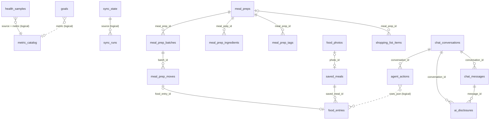

# Even: Low-Level Design (LLD)

Status as of 26 Oct 2026, phase 1, schema version 7. This document describes the code: modules, interfaces, the full schema, the algorithms and file formats, error handling and tests. It assumes you have read [HLD.md](HLD.md). Reasons for decisions are in [architecture.md](architecture.md).

## 1. Repository layout

The tree follows the three layers in [HLD section 3](HLD.md#3-components): UI, core logic and platform adapters. Everything below `apps/` is shared by every target (Android, the web app, iOS in a later phase: [phases.md](phases.md)); a target keeps only what is its own in `apps/<target>/`. A feature's logic lives in `domain/<name>/` and its screens in `screens/<name>/`, so a target can replace a screen without touching the logic, the schema or the backup format.

```
src/
  apps/<target>/main.tsx           one entry per target: android (the APK), web (Vercel); never imports another target
    android/TabBar.tsx, android.css  Android's navigation (Target.Frame): the five tabs in a bar at the bottom
    web/connectGate.tsx            the web's start: connect to the account before the app shows (Target.gate)
    web/SideNav.tsx, media.ts, web.css  the web's navigation (Target.Frame): a side menu, a drawer on a phone, docked on wide screens, and the wide layouts
                                   the Vite mode picks it: `vite build --mode web` is the web app, any other mode Android
  shell/                           the app frame both targets share for now (the composition root)
    start.tsx                      startApp(target): initLogging(), start the DB open, render <App />
    target.ts                      Target: what an entry adds to the shared shell (its navigation frame, a gate)
    tabs.ts                        the five sections in order, for every target's navigation
    App.tsx                        DB open, stored log level, auto sync, tabs and the pages over the Dashboard; the target's gate if it has one
    screens.tsx                    every screen but the Dashboard, lazy; preloadScreens
    logging.ts                     default level (debug in dev, info built), uncaught-error hooks
    Gallery.tsx, perfSeed.ts       UI kit gallery (dev only), perf build seed
  core/                            pure helpers, no app or platform imports
    log.ts                         createLogger, levels, sinks, redaction, recentLogs ring buffer
    health.ts                      health maths (BMR/TDEE, BMI, macros, alcohol, HR zones, series stats)
    tz.ts, uuidv7.ts               timezone helpers (Intl), UUIDv7
    secretStore.ts                 SecretStore interface + memory store
    notifier.ts                    Notifier interface (local notifications) + no-op
  db/                              storage plumbing, no feature logic
    driver.ts                      SqlDriver interface
    tx.ts                          withTransaction (nests by joining the outer transaction)
    migrate.ts, migrations.ts      runner and the Vite import of migrations/*.sql
    migrations/0001..0011_*.sql    schema (section 4)
    settings.ts                    app_settings get/set, deviceId
  platform/                        the only code that imports Capacitor plugins at runtime
    openDatabase.ts                encryption secret, connection, migrate
    sqlite.ts                      SqlDriver on @capacitor-community/sqlite
    secureStore.ts                 Keystore/Keychain SecretStore
    nativeFetch.ts                 fetch look-alike over CapacitorHttp (request injected)
    device.ts                      isNative, nativeRequest, deviceFetch, shareText
    notifications.ts               Notifier on @capacitor/local-notifications (no-op in the browser)
    files.ts                       backup file to the share sheet / download
    buildInfo.ts                   APP_VERSION and BUILD_TIME (defined by vite.config.ts from package.json)
  ui/                              the UI kit: presentational components, plain props in, callbacks out (section 8b)
    common.tsx                     shared screen helpers: Msg, failed(), dates, TagChips
    charts/                        LineChart, BarChart, CalendarHeatmap, StatTile, Sparkline, Meter, StackedBar; scale.ts (pure)
    mealprep/                      StockSummary, DefrostTimeline, StockAlerts, BatchBar; timeline.ts (pure)
    nutrition.tsx, controls.tsx    CalorieMeter, MacroSplit; RangePicker, Stepper, StatusBadge
    palette.css                    every color by role (light and dark), chart series, radii: the only place colors are defined
    layout.tsx                     PageHeader, SubTabs, Segmented: the frame every screen uses
    icons.tsx                      Icon: the app's line icons
    ui.css                         kit styles
  domain/<name>/                   shared by every target: logic and SQL per feature, no UI, no platform (runs in Node)
                                   (the list names each feature's screens too: they sit in screens/<name>/)
    cloudsync/                     sync session, keys and sealing, server API (admin calls too), friends; screens: SyncSettings, FriendsSettings, ConnectPanel, admin/AdminSettings
    metrics/                       samples, catalog, queries
    dashboard/                     dashboard.ts (spans, per-day figures, totals and averages); DashboardScreen, ProfileButton
    sync/                          runSync, GarminApi + GarminSource, staleness and reminder, Source types
    food/                          food log, saved meals, photos, calorie goal, suggestions; screens: TodayView, HistoryView, SavedView (shown in the Meal prep tab)
    mealprep/                      recipes, batches, stock fold and defrost plan, shopping list, supermarket spending (spending.ts); screens: Stock, Recipes, Shopping, Spending
    alcohol/                       drink types, drink log, totals in kcal and money, weight without alcohol; screens: AlcoholScreen (the Alcohol tab), AlcoholView
    journal/                       journal.ts (inserts the chat uses), entries.ts (measurement kinds, add/list/delete/restore, per-day series, day notes saved in place); screens: JournalScreen
    chat/                          engine, read tools, write tools (actions), consent, store, prompt, client, service, bubbles (what a stored message shows); screens: ChatScreen
    backup/                        exportBackup, restoreBackup, BACKUP_TABLES
    settings/                      secrets, log level, profile (owner profile and estimates), data inventory; SettingsScreen with Profile, Connections, Privacy, Debug logs and About pages
    logs/                          LogsScreen (Settings > Debug logs), report.ts (Markdown report for Claude, pure)
    me/                            MeScreen (the profile, opened from the Dashboard); sports, workouts, goals (progress), goal templates (pure logic); screens: avatar
  screens/<name>/                  shared screens per feature (*.tsx and their view helpers); styles.css
tests/                             node:test suites, fixtures, fakes; setup.ts silences logs
scripts/                           probe, PC sync, PC chat, Drizzle spike, Android hardening
docs/                              this documentation
capacitor.config.json              app id, SQLite encryption settings
```

Dependency rules, enforced by `tests/architecture.test.ts`:

| Layer | May import |
|---|---|
| `core/` | `core/` |
| `db/` | `db/`, `core/` |
| `platform/` | `platform/`, `db/`, `core/`, Capacitor plugins |
| `ui/` | `ui/`, `core/` |
| `domain/` | other domain folders, `db/`, `core/` |
| `screens/` | other screens, `domain/`, `ui/`, `platform/`, `db/`, `core/` |
| `shell/` | `screens/` and every layer below |
| `apps/<target>/` | its own folder, `shell/` and every layer below; never another target |

On top of that, nothing in `core/`, `db/`, `domain/` or `ui/` reaches a Capacitor plugin at runtime, not even through another module (the test follows the import graph; `import type` is allowed). That is what keeps all logic runnable in Node tests and PC scripts. Platform pieces reach the logic as parameters: `new GarminApi({ apiKey, fetch: deviceFetch(...) })`, `chatDeps(db, { secrets, fetch })`.

## 2. Core interfaces

```ts
// src/db/driver.ts
type SqlValue = string | number | null;
interface SqlDriver {
  exec(sql: string): Promise<void>;                                   // no params, no result, may be several statements
  run(sql: string, params?: SqlValue[]): Promise<void>;                // one parameterised statement
  all<T>(sql: string, params?: SqlValue[]): Promise<T[]>;             // rows as objects keyed by column name
}

// src/domain/sync/types.ts
interface Source {
  readonly id: string;                                                 // "garmin"
  fetchSince(cursor: string | null): Promise<SyncResult>;
}
interface SyncResult {
  samples: SampleInput[];
  catalog?: CatalogEntry[];                                            // when the source listed its metrics
  nextCursor: string | null;                                           // opaque, stored in sync_state
  warnings?: string[];
}
interface SampleInput {
  source: string; device: string; externalId: string; metric: string;
  startMs: number; endMs?: number; offsetMin: number;
  valueNum?: number; valueText?: string; unit?: string; raw?: unknown;
}

// src/domain/settings/secrets.ts
interface SecretStore {
  get(key: string): Promise<string | null>;
  set(key: string, value: string): Promise<void>;
  remove(key: string): Promise<void>;
}
```

Implementations:

| Interface | Phone | Tests / PC |
|---|---|---|
| `SqlDriver` | `capacitorDriver(conn)` | `memoryDriver()` on `node:sqlite` (`tests/helpers.ts`); `capacitorDriver(fakePlugin().conn)` (`tests/fakePlugin.ts`); file DB in `scripts/garmin-sync.ts` |
| `Source` | `GarminSource` over `GarminApi` with the native fetch | `GarminSource` over a fake Garmin server (`tests/garminSource.test.ts`); plain fake sources (`tests/runSync.test.ts`) |
| `SecretStore` | `secretStore` (Keystore/Keychain) | `memorySecretStore()` (also used by the browser build) |

## 3. Database access

### 3.1 Opening (`src/platform/openDatabase.ts`)

1. Refuse on non-native platforms (`Capacitor.isNativePlatform()`), with the message the shell shows.
2. If `isSecretStored()` is false, `setEncryptionSecret(hex of 32 random bytes)`. The plugin keeps it in its secure store.
3. `checkConnectionsConsistency()` + `isConnection("health")`: reuse the native connection after a WebView reload, otherwise `createConnection("health", encrypted=true, mode="secret", version=1, readonly=false)`.
4. `open()` if not open. The plugin enables foreign keys on open.
5. `migrate(capacitorDriver(conn), migrations)`.

`openDatabase()` caches its in-flight promise, because React StrictMode runs effects twice and two concurrent `createConnection` calls for one name fail. A failed open is not cached, so it can be retried.

The plugin's own version system is not used: with `version=1` and no `addUpgradeStatement`, it never touches `PRAGMA user_version`, so `migrate()` owns it.

Config (`capacitor.config.json`): `androidIsEncryption: true`, `iosIsEncryption: true`, `iosKeychainPrefix: "app.health.personal"`, biometrics off.

### 3.2 Capacitor driver (`src/platform/sqlite.ts`)

It depends only on `PluginConnection = Pick<SQLiteDBConnection, "execute" | "run" | "query" | "beginTransaction" | "commitTransaction" | "rollbackTransaction">`.

| Plugin behaviour | What the driver does |
|---|---|
| `execute()` and `run()` wrap each call in their own transaction unless passed `false` | Always passes `transaction=false`. `exec("BEGIN" / "COMMIT" / "END" / "ROLLBACK" [TRANSACTION])` maps to `beginTransaction` / `commitTransaction` / `rollbackTransaction`, so callers control transactions as on any SQLite |
| Android `execute()` splits the script on `";\n"`, strips `--` comments line by line, and runs each piece as a single statement | Normalises `\r\n` and `\r` to `\n` first. Without that, a CRLF file becomes one piece and only its first statement runs, with no error |
| iOS `query()` may return a first row `{ ios_columns: [...] }` | Drops it |
| `run()` has a `returnMode` | Passes `"no"` |

Consequences for SQL written for this app: no semicolons inside comments in multi-statement scripts, no `--` inside string literals in migration files, and no triggers (the plugin's trigger handling is not tested).

### 3.3 Migrations (`src/db/migrate.ts`)

- Files: `src/db/migrations/NNNN_name.sql`, inlined by Vite (`import.meta.glob(..., { query: "?raw", eager: true })`), read from disk in tests and scripts.
- `parseMigrations(files)`: parses the version from the file name, sorts, rejects bad names and duplicate versions.
- `migrate(db, migrations)`: reads `PRAGMA user_version`; for each newer migration runs `BEGIN`, the file, `PRAGMA user_version = N`, `COMMIT`. On error: `ROLLBACK` and throw `Migration N_name failed: ...`. The DB stays at the last good version. Returns the versions applied.

### 3.4 Write helpers

| Function | SQL behaviour |
|---|---|
| `upsertSamples(db, samples, nowMs, newId)` | One transaction. `INSERT ... ON CONFLICT (source, device, metric, external_id) DO UPDATE` of times, values, unit, raw, `local_day`, `updated_at`. The `id` and `created_at` of an existing row are kept |
| `sampleLocalDay(s)` | `new Date(startMs + offsetMin * 60000).toISOString().slice(0, 10)`. Same rule as the SQL backfill in 0002 |
| `saveSyncState(db, source, cursor, nowMs, error)` | Upsert. On success sets `last_synced_ms`; on error keeps the previous `last_synced_ms` and stores `last_error` |
| `loadCursor(db, source)` | Cursor or `null` |
| `upsertCatalog(db, source, entries, nowMs)` | Insert with a guessed `category` and `daily_agg` (`classifyMetric`: a rule on the name, then `DAILY_AGG_OVERRIDES` for Garmin metrics the rule gets wrong, such as `activity_aerobicTrainingEffect` = max, so a day with two workouts is not summed). On conflict refreshes only `unit`, `device` (when given), `first_day`, `last_day`, `records`, `updated_at` |
| `getSetting`, `setSetting`, `deviceId` | `app_settings` key/value. `deviceId` creates a UUIDv7 on first use |

`classifyMetric(name)` rules, first match wins: `sleep_*` -> sleep/last; `dailyBodyBattery_*` or contains `hrv` -> recovery/last; `stress_*` or contains `stress` -> stress/avg; contains `heartrate` or `pulseOx_*` -> heart/avg; `body_*`, `userMetrics_*` -> body/last; `nutrition_*`, `food_*`, `drink_*` -> nutrition/sum; `daily_*`, `activity_*`, contains `steps` -> activity/sum; otherwise other/avg.

### 3.5 Read helpers (`src/domain/metrics/queries.ts`)

- `latestSampleDay(db)`: `MAX(local_day)` of `health_samples`.
- `dayValues(db, day)`: `daily_metric_values` left-joined with `metric_catalog`, ordered by pinned, `sort_order`, category, metric. Picks `avg_num` / `sum_num` / `min_num` / `max_num` / `last_num` according to `daily_agg` (default `avg`). Returns label (catalog label or metric name), device, unit, readings and the partial flag.

### 3.6 Logging (`src/core/log.ts`)

`createLogger(scope)` returns `debug / info / warn / error`, `time(msg, level?)` (logs `ms` when the returned function is called) and `child(sub)` (scope `parent.sub`). Levels: `debug < info < warn < error < silent`. `setLogLevel(level)` sets the global threshold and `setLogLevel(level, scope)` overrides it for a scope and its children (`sync` covers `sync.garmin`).

Records are `{ ts, level, scope, msg, fields }`. Every record goes to `consoleSink` (one line: `12:00:01.234 INFO  sync: sync finished {"samples":10,"ms":812}`) and to `recentLogs`, a 500-record ring buffer in memory that Settings > Debug logs shows. Nothing is written to disk; records leave the phone only when the owner exports or shares them from that page. A sink that throws is ignored.

Fields are sanitised before any sink sees them: keys matching key, token, secret, password, passphrase, authorization, cookie or url become `[redacted]`; errors become `{ name, message }` (validation errors as `path: message` per issue); strings are cut at 200 characters, arrays over 20 items and objects deeper than 2 levels are summarised.

Level in force: `shell/logging.ts` sets `debug` in `npm run dev` and `info` in the built app before React renders; once the DB is open, `applyStoredLogLevel` applies `app_settings` key `log.level` if set (changed in Settings, `saveLogLevel`). Tests run with `silent` (`tests/setup.ts`, `LOG_LEVEL=debug npm test` to see them); scripts use `LOG_LEVEL` or `info`.

What is logged, by scope:

| Scope | Events |
|---|---|
| `app` | start (level, native), database unavailable, uncaught errors and rejections, sync skipped |
| `db.open`, `db.migrate`, `db` | open time, first-launch secret, connection reuse; each migration applied (version, name, ms), failure; transaction rollback (debug) |
| `http.native` | each native request (method, status, ms; debug), failures (warn) |
| `sync`, `sync.garmin` | start (cursor), finish (samples, catalog, warnings, cursor, ms), each warning, failure; window, time zone, token obtained (validity in minutes) and sample count (debug) |
| `metrics` | samples upserted (count, ms), catalog refreshed (debug) |
| `backup` | export (tables, rows, bytes, ms), restore (rows, ms), every refusal and rollback |
| `chat`, `chat.actions`, `chat.store`, `chat.consent` | each request and reply (model, stop reason, tokens, tool uses, ms), fallback, refusal, request errors; each tool (name, data class, bytes, ms) and each blocked or failed tool; proposals (approved or not), recorded and undone agent actions; consents |
| `food`, `mealprep`, `mealprep.shopping`, `journal` | every write and delete, by id and kind (meal slot, move kind, portions, has photo), refusals at debug |
| `settings`, `settings.secrets` | log level changes; keys saved or removed, old freddy credentials removed (never the values) |
| `ui.<feature>` | actions a screen reported as failed (info: usually input the core refused) |

Pure modules (`core/health.ts`, `tz.ts`, `stock.ts`, `suggest.ts`, the Garmin export parser) do not log: they have no side effects worth recording, and their callers log the outcome.

Privacy rule (architecture.md section 3): log what happened, not the data. Ids, counts, kinds, durations and statuses only; never health values, food or recipe names, notes, chat text, URLs or keys. `tests/logging.test.ts` runs real flows with recognisable values and fails if any reaches a record.

### 3.7 Transactions (`src/db/tx.ts`)

`withTransaction(db, fn)` wraps `fn` in `BEGIN` / `COMMIT` and rolls back on error. A call made inside another `withTransaction` on the same driver joins the outer transaction (SQLite cannot nest `BEGIN`), so for example a chat write tool can call `saveMealPrep` inside its own transaction and one failure undoes both. `migrate()` and `restoreBackup()` keep their own `BEGIN` because they wrap errors in their own messages.

### 3.8 Health calculations (`src/core/health.ts`)

Pure functions, no dependencies, shared by screens and (later) the chat tools. Inputs are validated: bad values throw `RangeError` with the field name.

| Area | Functions | Formula |
|---|---|---|
| Age | `ageOn(birthDay, day)` | whole years, birthday counts on the day |
| Body | `bmi`, `bmiClass`, `healthyWeightRange` | kg/m², WHO adult classes 18.5 / 25 / 30, range = BMI 18.5 to 24.9 |
| Energy | `bmr`, `tdee`, `calorieTarget`, `kgPerWeekFromBalance` | Mifflin-St Jeor; activity factors 1.2 / 1.375 / 1.55 / 1.725 / 1.9; 7700 kcal per kg; target rounded to 10 kcal and never below BMR (`floored` says so) |
| Nutrition | `kcalFromMacros`, `macroSplit`, `proteinTarget` | Atwater 4 / 4 / 9 / 7 kcal per g (protein, carbs, fat, alcohol); protein default 1.6 g/kg |
| Alcohol | `alcoholGrams`, `standardDrinks`, `alcoholKcal` | ml x ABV / 100 x 0.789 (same as `daily_alcohol`); standard drink 10 g (ES, EU), 8 g (UK), 14 g (US); kcal = grams x 7 (alcohol only, so sugary drinks are undercounted) |
| Weight | `weightWithoutKcal(kg, kcal)` | kg - kcal / 7700: the weight without those kcal if they were not made up for elsewhere (an upper bound) |
| Heart rate | `maxHeartRate`, `heartRateZones` | Tanaka 208 - 0.7 x age; five zones 50 to 100 % in 10 % steps, of the heart rate reserve (Karvonen) when a resting rate is given |
| Series | `mean`, `slopePerDay`, `rollingAverage`, `smoothed` | least squares over calendar days; trailing window by calendar days, gaps not counted as zero; exponential smoothing (alpha 0.1 default) |

The food log form uses `kcalFromMacros` to estimate kcal when only macros are typed, and History uses `mean`. The chat tools use `slopePerDay`, `alcoholGrams` and the energy functions from here.

## 4. Schema

Version 11 (`0001_init.sql` to `0011_shopping_trips.sql`). 0008 to 0010 change data and views only, no tables: 0008 renames old export metric names and hides an export day another source has; 0009 ranks sources in `daily_metric_values` (Personal API, freddy, export) and converts export activity kcal from kJ; 0010 sets `daily_agg` for the metrics in `DAILY_AGG_OVERRIDES` where a row still holds the old name-based guess, and deletes the `freddy.transport` setting. 0011 adds `shopping_trips` (supermarket spending). Conventions: ids are UUIDv7 text; `*_ms` are UTC epoch ms; `offset_min` is minutes east of UTC; `local_day` is `YYYY-MM-DD`. "Std" below means the user-table columns `created_at INTEGER NOT NULL, updated_at INTEGER NOT NULL, deleted_at INTEGER, origin_device_id TEXT NOT NULL`.



Only the `chat_*`, `ai_disclosures` and `meal_prep_*` / `shopping_list_items` links are real foreign keys; the others are logical (matching values, no constraint).

### 4.1 Synced data

**`health_samples`**: one reading from a source.

| Column | Type | Notes |
|---|---|---|
| `id` | TEXT PK | UUIDv7 |
| `source` | TEXT NOT NULL | `garmin` (Personal API), `garmin_export` (account export), `freddy` (rows from before 26 Oct 2026) |
| `device` | TEXT NOT NULL DEFAULT '' | `Garmin` for both Garmin sources; freddy's source label for its rows |
| `external_id` | TEXT NOT NULL | `<day>#0` for day metrics, `activity:<id>` for workouts, `weight:<samplePk>` for weigh-ins (sync); freddy used `<day>#<n>` |
| `metric` | TEXT NOT NULL | provider metric name, e.g. `daily_steps` |
| `start_ms`, `end_ms` | INTEGER | local day start and next day start, in UTC ms |
| `offset_min` | INTEGER NOT NULL DEFAULT 0 | |
| `value_num` / `value_text` | REAL / TEXT | `value_text` when the value is not `<number> [unit]` |
| `unit` | TEXT | canonical: `meters`, `seconds`, `kcal`, `bpm`, `grams`, `ms`, `%`, ... |
| `raw_json` | TEXT | `{"partial":true}` when the day was not over |
| `local_day` | TEXT | added in 0002, backfilled |
| `created_at`, `updated_at` | INTEGER NOT NULL | |

Unique (source, device, metric, external_id). Indexes: (metric, start_ms), (metric, local_day).

**`metric_catalog`**: PK (source, metric). Source facts: `unit`, `device`, `first_day`, `last_day`, `records`. User choices: `label`, `category` (sleep, recovery, activity, heart, stress, body, nutrition, other; default other), `daily_agg` (avg, sum, min, max, last; default avg), `higher_is_better` (0/1/NULL), `pinned` (0/1), `sort_order`. Plus `updated_at`.

**`sync_state`**: PK `source`; `cursor`, `last_synced_ms`, `last_error`, `updated_at`.

**`sync_runs`**: `id`, `source`, `started_ms`, `finished_ms`, `status` (running, ok, error), `cursor_before`, `cursor_after`, `samples_written`, `warnings_json` (JSON array or NULL), `error`. Index (source, started_ms).

### 4.2 Logs written by the owner

| Table | Columns besides Std | Constraints / indexes |
|---|---|---|
| `food_entries` | `id`, `eaten_at_ms`, `offset_min`, `local_day`, `name`, `meal`, `calories`, `protein_g`, `carbs_g`, `fat_g`, `notes` | `meal` in breakfast, lunch, dinner, snack, prep. Index on `eaten_at_ms` and on `local_day`, live rows only |
| `drink_entries` | `id`, `drunk_at_ms`, `offset_min`, `local_day`, `name`, `volume_ml` NOT NULL, `abv_percent` NOT NULL, `notes`; 0006: `drink_type_id` FK, `calories`, `price` (per drink, copied from the type when logged; NULL kcal = estimate) | Index on `drunk_at_ms`, `local_day` and `drink_type_id`, live rows only |
| `manual_measurements` | `id`, `measured_at_ms`, `offset_min`, `local_day` NOT NULL, `kind` NOT NULL, `value_num`, `value_num2`, `value_text`, `unit`, `notes` | `kind` free text (weight, blood_pressure, glucose, supplement, symptom...). `value_num2` = second number of a pair (diastolic). Index (kind, local_day), live rows |
| `day_notes` | `id`, `local_day` NOT NULL, `mood`, `energy`, `body` | `mood`, `energy` between 1 and 5. Unique `local_day` among live rows |
| `goals` | `id`, `title`, `target_kind`, `metric`, `comparator`, `target_num`, `unit`, `period`, `start_day` NOT NULL, `end_day`, `notes` | `target_kind` in sample, manual, food, drink, none. `comparator` in `>=`, `<=`. `period` in day, week, month (default day). CHECK: `target_kind = 'none'` or metric, comparator and target_num all set |

`local_day` on `food_entries` and `drink_entries` was added in 0002 (nullable, backfilled). Code that inserts these rows must set it; use `food.ts` for food and `logs.ts` for the other four.

0005 adds `created_by` (`user` or `assistant`, default `user`) to the five tables above and to `meal_preps`, `meal_prep_batches`, `saved_meals` and `shopping_list_items`: the rows the chat agent can create.

### 4.2b Meal prep (0003)

| Table | Columns besides Std | Constraints / indexes |
|---|---|---|
| `meal_preps` | `id`, `name`, `portions` (per batch, default 4), `fridge_days` (4), `freezer_days` (90), `thaw_hours` (24), `calories`, `protein_g`, `carbs_g`, `fat_g` (per portion), `notes` | counts > 0, `thaw_hours` >= 0 |
| `meal_prep_ingredients` | `id`, `meal_prep_id` FK, `sort_order`, `name`, `quantity`, `unit` | `quantity` NULL or > 0. Index (meal_prep_id), live |
| `meal_prep_tags` | `id`, `meal_prep_id` FK, `tag` | `tag` non-empty, already `lower(trim())`. Unique (meal_prep_id, tag) among live rows. Index (tag), live |
| `meal_prep_batches` | `id`, `meal_prep_id` FK, `cooked_at_ms`, `offset_min`, `local_day`, `portions`, `notes` | `portions` > 0. Index (meal_prep_id), live |
| `meal_prep_moves` | `id`, `batch_id` FK, `at_ms`, `offset_min`, `local_day`, `kind`, `from_loc`, `portions`, `food_entry_id` FK | `kind` in freeze (from fridge), thaw (from freezer), eat (from fridge), discard (either). Append only, undo = soft delete. Index (batch_id, at_ms), live |
| `shopping_list_items` | `id`, `name`, `quantity`, `unit`, `checked` (0/1), `meal_prep_id` FK (where it came from) | Index (checked, name), live |
| `shopping_trips` (0011) | `id`, `shop` (supermarket as typed), `amount` (paid, in the app currency like drink prices), `paid_at_ms`, `offset_min`, `local_day`, `items` (ticked list items it cleared, or NULL), `notes`, `created_by` | `shop` non-empty, `amount` > 0. Index (local_day), live |

Stock is never stored. `loadStock` reads live batches that still have portions (`portions` > eaten + discarded, in SQL) and `foldBatch` replays their moves: every portion starts in the fridge with eat-by `local_day + fridge_days`; freeze takes the fridge lot that goes off first and makes a freezer lot (best by `freeze day + freezer_days`); thaw takes the oldest freezer lot and makes a fridge lot ready at `at_ms + thaw_hours`, eat-by `thaw day + ceil(thaw_hours / 24) + fridge_days`; eat prefers lots already ready. `addMove` refuses more portions than the location holds; `undoMove` refuses when the remaining moves would overdraw (for example undoing a defrost whose portion was eaten). Eating writes a `food_entries` row (`meal = 'prep'`, macros x portions); undo and `deleteBatch` soft-delete it too. Deleting a recipe keeps its batches in stock.

`planDefrost` simulates the next 7 days at `portions_per_day` (setting `meal_prep.portions_per_day.<tag|all>`, default 1, minus portions eaten today): each day eats from ready fridge lots by eat-by, and covers any gap from the freezer lot with the earliest best-by, advising to start the defrost `ceil(thaw_hours / 24)` days earlier (`late` when that day is past). It also reports days nothing covers and fridge portions that will pass eat-by uneaten. `stockAlerts` lists expired, due today/tomorrow, still defrosting and past-best-by freezer lots.

Shopping: `addShoppingItem` merges into an open (unchecked) item with the same name (case-insensitive) and unit, after folding g/kg and ml/cl/dl/l into g and ml. `addRecipesToShopping` adds each recipe's ingredients x batches in one transaction.

### 4.2c Food log (0004)

| Table | Columns besides Std | Constraints |
|---|---|---|
| `food_photos` | `id`, `mime` (image/jpeg, image/webp), `data_b64`, `width`, `height`, `bytes` | The app sends at most 1024 px JPEG, re-encoded through a canvas (no EXIF). `food.ts` rejects non-base64 data and more than 1.5 MB |
| `saved_meals` | `id`, `name`, `meal` (usual slot), `calories`, `protein_g`, `carbs_g`, `fat_g` (per serving), `notes`, `photo_id` FK | Same `meal` values as `food_entries` |
| `food_entries` | + `saved_meal_id` FK | Index (saved_meal_id), live |

Photos are only kept with saved meals: logging with a photo bookmarks the meal. Use counts and "last eaten" are not stored, they come from the entries linked by `saved_meal_id`. `saveEntryAsMeal` also links earlier live entries with the same name (case-insensitive) that have no live saved meal. Deleting a saved meal soft-deletes it and its photo; its entries stay in the history, without a photo. Replacing a photo soft-deletes the old one.

The daily calorie target is a `goals` row (`target_kind = 'food'`, `metric = 'calories'`, `comparator = '<='`, `period = 'day'`, unit kcal). `setCalorieGoal` keeps one live row: a change on a later day sets `end_day` on the old one before soft-deleting it, a change on the same day replaces it.

`deleteFood` on an entry made by eating a meal prep portion calls `undoMove`, so the portion goes back into stock. `relogFood` copies an entry to now; a copied meal prep entry gets the slot for the hour instead of `prep` and does not touch stock.

`suggestions` offers saved meals plus anything else logged at least twice in the last 30 days (by lower-case name, `prep` excluded). `rankSuggestions` scores: uses in 30 days (capped at 10), +4 if its usual slot (most logged slot, else the saved slot) matches `mealForHour(now)` (5-10 breakfast, 11-15 lunch, 16-18 snack, otherwise dinner), +2 if saved, +1 if eaten in the last 3 days, -6 if already logged today.

### 4.2d Alcohol (0006)

| Table | Columns besides Std | Constraints |
|---|---|---|
| `drink_types` | `id`, `name`, `volume_ml` (one serving), `abv_percent`, `calories` and `price` (per serving, both optional), `created_by` | Unique `lower(name)` among live rows. `volume_ml` > 0, ABV 0 to 100, kcal and price >= 0 |

Prices are in the currency in `app_settings` key `currency` (ISO code, default EUR). Each drink stores its own kcal and price, so editing or deleting a type never rewrites history. `logDrink` takes a type (its values are defaults, any can be overridden) or a name, ml and ABV, and a count (1 to 20 rows). Totals come from `daily_alcohol`; kcal is the stored value or 7 kcal per gram of alcohol, and money only counts drinks with a price (`priced` says how many).

`latestWeight(db, day)` takes the newest of a manual `weight` measurement (unit kg, g or lb; kg if empty) and a synced `body_weightInGrams` sample, on or before the day. `weightWithoutAlcohol(db, from, to)` = that weight - drink kcal in the range / 7700.

### 4.3 Claude

| Table | Columns besides Std | Constraints |
|---|---|---|
| `chat_conversations` | `id`, `title`, `model` | Index on `updated_at`, live rows |
| `chat_messages` | `id`, `conversation_id` FK, `seq`, `role`, `content_json`, `model`, `stop_reason`, `input_tokens`, `output_tokens` | `role` in user, assistant. Unique (conversation_id, seq). `content_json` = the Anthropic content blocks array, verbatim |
| `ai_disclosures` | `id`, `conversation_id` FK, `message_id` FK, `sent_at_ms`, `tool_name`, `data_class`, `summary`, `payload_json`, `bytes` | `data_class` in aggregate, raw, note, photo, file (photo added in 0005, file in 0015, each by rebuilding the table; rows kept). Index on `sent_at_ms` |
| `consents` | `id`, `scope`, `granted` (0/1), `decided_at_ms`, `policy_version` | Index (scope, decided_at_ms). Newest row per scope is in force |
| `agent_actions` (0005) | `id`, `conversation_id` FK, `tool_name`, `summary`, `input_json`, `status`, `rows_json`, `error`, `decided_at_ms` | `status` in applied, declined, failed, undone. `rows_json` = the effects to reverse (`{op, table, id}`, plus `before`/`after` for a shopping-list merge). Index (conversation_id, decided_at_ms) |

### 4.3b Account (0007)

**`account`**: at most one live row, `id = 'owner'` (CHECK). `provider` (`google`), `subject` (Google `sub`, non-empty), `email`, `email_verified` (0/1), `name`, `bound_at_ms`, `last_sign_in_ms`, `signed_in` (0/1, the local session) + Std. No token columns.

Code: `src/domain/account/account.ts` (pure) and `service.ts`, platform wrapper `src/platform/googleSignIn.ts`.

| Function | Does |
|---|---|
| `parseGoogleIdToken(token, { webClientId, now })` | Decodes the JWT payload and checks `iss` (accounts.google.com), `aud` (= Web client id, string or array), `exp` (5 min skew) and `sub`. Signature not checked on the phone (architecture.md 5b). Messages safe to show |
| `applySignIn(db, identity, deviceId, now)` | No owner: insert (or re-bind a released row) -> `bound`; same `sub`: refresh email and name, `signed_in = 1` -> `signed_in`; other `sub`: no change -> `other_owner` with the owner's email |
| `signOut(db)` | `signed_in = 0`; binding kept |
| `releaseOwnership(db)` | Soft-deletes the row; the next sign-in binds. UI confirms first |
| `assertSameOwner(current, backupSubject, backupEmail)` | Used by `restoreBackup` before merging anything |
| `signInWithGoogle(db, { signIn, webClientId })` | Platform sign-in -> token -> checks -> `applySignIn`; also `cancelled` and `error` (plugin details are logged, not shown) |
| `signOutOfGoogle(db, { signOut })` | Local sign-out first, then the device's Google state (a plugin failure is only logged) |

`googleSignIn()` initializes `SocialLogin` once with `{ google: { webClientId, mode: "online" } }`, logs in with scopes `email`, `profile`, returns the ID token, or `null` on `USER_CANCELLED`. `googleSignInAvailable` is true only in the native app with `VITE_GOOGLE_WEB_CLIENT_ID` set at build time.

### 4.4 Settings

**`app_settings`**: PK `key`; `value`, `updated_at`. Keys in use: `device_id` (UUIDv7 of this install, never restored from a backup), `sync.reminder` (`off` turns the 3-day reminder off; anything else, or unset, is on), `log.level`, `currency`, `meal_prep.portions_per_day.<tag|all>`.

### 4.5 Views

| View | Grain | Columns |
|---|---|---|
| `daily_metric_values` | metric, local_day, source, device (numeric samples with a `local_day`; one source per metric and day: `garmin`, then `freddy`, then `garmin_export`, 0008 and 0009) | `readings`, `avg_num`, `sum_num`, `min_num`, `max_num`, `last_num` (latest by `start_ms`, then `rowid`), `unit`, `partial` (1 if any row's `raw_json` has `"partial":true`) |
| `daily_nutrition` | local_day, live food rows | `entries`, `calories`, `protein_g`, `carbs_g`, `fat_g` |
| `daily_alcohol` | local_day, live drink rows | `drinks`, `volume_ml`, `alcohol_g` = sum(ml x ABV / 100 x 0.789), `calories` (stored, else alcohol_g x 7), `calories_estimated` (rows without a kcal), `price` (sum of known prices), `priced` (rows with a price). Rebuilt in 0006 |

## 5. Garmin source (`src/domain/sync/garmin.ts`)

Garmin Connect Personal API, read-only, with the owner's personal API key. Replaced the freddy source on 26 Oct 2026 (why: [architecture.md section 4b](architecture.md#4b-decision-26-oct-2026-read-garmin-directly-through-the-garmin-connect-personal-api)).

### 5.1 API client (`GarminApi`)

Options: `apiKey`, `fetch` (native adapter on the phone, global `fetch` otherwise), `baseUrl` (default `https://personal.connectapi.garmin.com`), `now`.

- **Token:** `POST /personalapitoken-service/personal-api/personal-api-key/token` with `authorization: ApiKey <key>` and `accept: */*` (asking for JSON gets HTTP 406). The reply is the token as plain text. `parseTokenReply` also accepts a JSON string or an object with `access_token`, `accessToken` or `token`, and `expires_in` / `expiresIn` (seconds) or `expiresAt` / `expires_at` (seconds or ms). Without an expiry the token is kept 23 h. It lives in memory only and is asked for again 5 minutes before it runs out.
- **Data:** `get(path, query)` sends `GET` with `authorization: Bearer <token>`, `accept: application/json`. A 401 drops the token and retries once. An empty body is `null`.
- **Errors** (`GarminApiError`, with `status`): 401/403 on the token -> "Garmin rejected the personal API key (HTTP n). It may have expired: make a new one in Garmin Connect."; other token failures -> "Garmin token request failed (HTTP n)"; data calls -> "Garmin <service> failed (HTTP n)"; network -> "Could not reach Garmin (...)"; a body that is not JSON. No message contains the URL, key or token.

### 5.2 Window and cursor (`GarminSource.fetchSince`)

Options: `api`, `timeZone` (fallback `Europe/Madrid`, replaced by the profile's `timeZone`), `firstSyncDays` (default 30), `now`.

```
tz        = GET /userprofile-service/userprofile/settings -> timeZone (fallback on failure, but a rejected key throws)
today     = local day of now() in tz
start     = cursor ? min(cursor, today) : today - (firstSyncDays - 1)
for each 28-day chunk [from, to] up to today:       (28 = the tightest per-call limit of the endpoints)
  daily summaries, sleep, HRV, weight -> samples
activities from start to today, 99 per page, until a short page
nextCursor = today - 1      (yesterday may have been incomplete)
```

An endpoint answering 403 or 404 becomes a warning (`"HRV: not available (HTTP 403)"`) and the sync goes on; any other failure throws, so `runSync` keeps the cursor. There is no history window: after a long pause the next sync reads every day since the cursor.

### 5.3 Mapping

Metric names are the Garmin export importer's (and freddy's), so each metric is one series across sources. Source `garmin`, device `Garmin`. Day metrics: `externalId = <day>#0`, `start_ms` = local midnight, `end_ms` = next local midnight, `offset_min` from the daily summary's `wellnessChronology` (`startTimestampLocal - startTimestampGmt`, strings without a zone), else from `tz`. Values outside a plausible range, `null` and Garmin's negative "no data" markers are skipped, never stored as 0. No `raw_json` is kept.

| Endpoint | Metrics |
|---|---|
| `GET /usersummary-service/v2/dailysummaries?startDate&endDate` -> `data[]` | `daily_steps`, `daily_distanceInMeters` (`movement.steps`), `daily_totalKilocalories`, `daily_activeKilocalories`, `daily_bmrKilocalories` (`calories`), `daily_restingHeartRateInBeatsPerMinute`, `daily_min/maxHeartRateInBeatsPerMinute` (`heartRate`, documented as 2-minute averages), `daily_moderate/vigorousIntensityDurationInSeconds` (minutes x 60), `daily_averageStressLevel`, `daily_maxStressLevel`, `daily_stressDurationInSeconds` (low + medium + high ms / 1000), `daily_restStressDurationInSeconds`, `dailyBodyBattery_highest/lowest/charged/drainedValue`, `pulseOx_avg/minSpo2InPercent` |
| `GET /sleep-service/sleep/dailySleepSummariesByDate?startDate&endDate` -> array | `sleep_durationInSeconds` (`sleepTimeSeconds`, else deep + light + REM), stage seconds, `sleep_awakeDurationInSeconds`, `sleep_averageSpO2`, `sleep_averageHeartRateInBeatsPerMinute` (`avgHeartRate`, else `averageSpO2HRSleep`), `sleep_averageRespiration`, `sleep_overallSleepScore` (`sleepScores.overall.value`, when sent) |
| `GET /hrv-service/hrv/daily/{from}/{to}` -> `hrvSummaries[]` (can be `null`) | `hrv_lastNightAvg`, `hrv_lastNight5MinHigh`, `hrv_weeklyAvg` (ms) |
| `GET /weight-service/weight/range/{from}/{to}?includeAll=true` -> `dailyWeightSummaries[].allWeightMetrics[]` | `body_weightInGrams`, one per weigh-in (`externalId = weight:<samplePk>`, `start_ms` = `timestampGMT`). Sent in grams although documented as kg (values under 1000 are read as kg). `sourceType = USER_SETTING` (the profile weight) is skipped. `weight/all` answers HTTP 400 and is not used |
| `GET /activitylist-service/activities/search/activities?startDate&endDate&start&limit=99` -> array | Per activity (`externalId = activity:<activityId>`, the same id as the export, `start_ms` = `beginTimestamp`, `end_ms` = start + duration, offset from `startTimeLocal - startTimeGMT`): `activity_activityType` (text, `activityType.typeKey`), `activity_durationInSeconds`, `activity_movingDurationInSeconds`, `activity_distanceInMeters` (metres, unlike the export), `activity_totalElevationGainInMeters`, `activity_activeKilocalories`, `activity_average/maxHeartRateInBeatsPerMinute`, `activity_steps`, `activity_aerobic/anaerobicTrainingEffect`, `activity_vo2Max`. Names, places and coordinates are not stored |

The catalog for each sync is built from the samples (`catalogFor`, shared with the export importer).

### 5.4 Native HTTP adapter (`src/platform/nativeFetch.ts`)

`makeNativeFetch(request)` returns a `typeof fetch`:
- Headers are normalised through `Headers` (lower-case keys).
- A string body with a JSON content type is parsed back to an object, because `CapacitorHttp` serialises `data` itself and would otherwise send a quoted string.
- Always requests `responseType: "text"`. If the plugin still hands back parsed JSON, it is re-serialised.
- Returns a real `Response` (null body for 204, 205, 304).
- A rejected request becomes `TypeError("Native HTTP request failed", { cause })`, the same shape as a failed `fetch`.

`App.tsx` builds `new GarminSource({ api: new GarminApi({ apiKey, fetch: deviceFetch(...) }) })`: the native adapter on the phone, the WebView's `fetch` in the browser build.

## 5b. Garmin export import (`src/domain/import/`)

`readGarminZip(bytes)` (fflate `unzipSync` with a filter) unpacks only the files `garminKind(path)` recognises, matched on their tail because some names start with the account email:

| Kind | File | Read as |
|---|---|---|
| daily | `DI-Connect-Aggregator/UDSFile_*.json` | One record per `calendarDate`. Offset = `wellnessStartTimeLocal - wellnessStartTimeGmt` (kept per day, reused for sleep, weight and VO2) |
| sleep | `DI-Connect-Wellness/*_sleepData.json` | One per night, stage seconds; total = deep + light + REM |
| biometrics | `DI-Connect-Wellness/*_userBioMetrics.json` | Weight rows only (grams). `sourceType = USER_SETTING` is the profile value: skipped. `calendarDate` here is a date-time |
| vo2max | `DI-Connect-Metrics/MetricsMaxMetData_*.json` | Per day and sport the latest `updateTimestamp` wins; also fitness age |
| activities | `DI-Connect-Fitness/*_summarizedActivities.json` | `distance`, `elevationGain` in **cm**, `duration`, `movingDuration` in **ms**; `avgSpeed` ((m/s)/10) not used. Start = `startTimeGmt`, offset = local - GMT |

`parseGarminExport(files, { timeZone })` returns samples (source `garmin_export`, device `Garmin`), catalog entries and a report per kind (files, records, imported, skipped, first/last day). Day metrics use `externalId = <day>#0` (weigh-ins `<day>#<sequence>`), activities `activity:<activityId>`. Each value is range-checked (steps 0–200k, heart rate 20–250, SpO2 50–100, stress and Body Battery 0–100, ...), so Garmin's -1/-2/null markers and impossible values are dropped. Metric names are freddy's for the same values (checked against freddy's list, 26 Oct 2026; 0008 renamed rows stored under the earlier names). Resting HR is `currentDayRestingHeartRate` (`restingHeartRate` is Garmin's 7-day average). Metrics: `daily_*` (steps, distance, kcal total/active/BMR, resting/min/max HR, moderate/vigorous/active/highly active durations, average/max stress, stress/rest durations), `dailyBodyBattery_*` (highest, lowest, charged, drained), `pulseOx_*`, `respiration_avgWakingBreathsPerMinute`, `sleep_*` (total, deep, light, REM, awake, SpO2, HR, respiration), `body_weightInGrams`, `userMetrics_vo2Max{Running,Walking,Cycling,}`, `userMetrics_fitnessAge`, `activity_*` (`activity_activityType` as text, duration, moving duration, distance, `activity_totalElevationGainInMeters`, kcal, average/max HR, steps, aerobic/anaerobic training effect, VO2 max). Not imported: names, locations, coordinates, hydration (only sweat estimates), nutrition (only goals), FIT files, routes, social, images, workouts, gear.

`storeGarminImport(db, parsed)` runs in one transaction: `upsertSamples` (idempotent), `upsertCatalog`, then `GARMIN_DAILY_AGG` defaults (max for training effect, VO2 and max HR/stress, min for min HR and lowest SpO2) only for catalog rows this import created, so the owner's later choices survive a re-import.

## 6. Sync orchestrator (`src/domain/sync/runSync.ts`)

```
runSync(db, source, now):
  if a run for source.id is in flight: return the same promise
  cursorBefore = loadCursor
  INSERT sync_runs (running, cursor_before)
  try:
    res = source.fetchSince(cursorBefore)
    upsertSamples(res.samples)                 one transaction
    if res.catalog: upsertCatalog
    saveSyncState(nextCursor)
    UPDATE sync_runs ok, cursor_after, samples_written, warnings_json
    return { status: "ok", ... }
  catch err:
    saveSyncState(cursorBefore, error=message)  cursor does not move
    UPDATE sync_runs error
    return { status: "error", error, ... }      never throws
```

If samples were written but a later step failed, the next run rewrites them in place (upserts are idempotent).

`lastSync(db, source)` returns the newest run (status, times, count, warnings, error) plus `lastOkMs`, the latest successful finish, so the UI can show "last successful sync" even after a failure.

**When the app syncs** (`src/shell/App.tsx`): on launch (after loading the status), with the header sync button on every tab, and when the app comes back to the front (`visibilitychange`) if the last success is more than an hour old (`RESYNC_ON_RESUME_MS`). `runSync` shares one run per source, so these never overlap.

**Staleness and the 3-day reminder** (`src/domain/sync/reminder.ts`, pure apart from settings):
- `freshness(lastOkMs, now)`: `never`, `fresh`, or `stale` from 3 days (`STALE_AFTER_MS`) after the last success. Stale or a failed last attempt shows `SyncBanner` above every tab and turns the header button amber.
- `nextReminderAt(lastOkMs, now)`: last success + 3 days, or now + 1 day once that has passed (repeats daily until a sync succeeds). Never synced: now + 3 days.
- `reminderText`: "No Garmin sync for N days", and that the Garmin key may have expired.
- `refreshSyncReminder(db, notifier, { configured })` keeps exactly one pending notification (id `SYNC_REMINDER_ID` = 1001, replaced on every call): it cancels it when no Garmin key is stored or `sync.reminder` is `off`, asks for the notification permission otherwise (Android 13+ shows the prompt the first time), and schedules it. Called at start, after every sync attempt and after any settings change. It never throws; failures are logged as `sync.reminder` warnings.
- The `Notifier` interface is in `src/core/notifier.ts`; `src/platform/notifications.ts` implements it with `LocalNotifications.schedule` and the options from `pluginNotification` (`allowWhileIdle: true`, `isExactNotification: false`: an exact alarm would make the plugin open Android 14+'s *Alarms & reminders* screen on every schedule), which Doze delivers close to the time. Tapping the notification opens the app, which syncs on launch.

## 7. Secrets and settings

| Key | Where | Written by |
|---|---|---|
| `garmin.api_key` | SecretStore | Settings → Connections (`saveGarminKey`: trimmed, at least 16 characters, no spaces). "Forget" removes it. The access token is never stored |
| `freddy.mcp_url`, `freddy.mcp_key` | SecretStore | No longer written. `removeLegacySecrets` deletes them on every start |
| `anthropic.api_key` | SecretStore | `connectClaude` after the key is verified (shape check `normalizeClaudeKey`, must look like `sk-ant-...`) |
| `claude.verified_at`, `claude.key_hint`, `claude.problem` | `app_settings` | `connectClaude` (time, last 4 characters), `watchConnection` (problem when a request is rejected; cleared on the next success), `disconnectClaude` (all cleared). Never the key itself |
| `claude.effort` | `app_settings` | `saveEffort`; default `medium` |
| SQLCipher passphrase | SQLite plugin secure store | `openDatabase()` on first launch |
| `device_id` | `app_settings` | `deviceId()`. (`freddy.transport` was deleted by migration 0010) |

`secretStore` (`src/platform/secureStore.ts`) uses `SecureStorage.getItem/setItem/removeItem` on native platforms and `memorySecretStore()` in the browser, so secrets typed into the dev build are never written to `localStorage`.

## 8. UI

`App.tsx` state: `dbStatus` (opening, ready with `db`, error with message), `tab` (dashboard, chat, mealprep, alcohol, settings), `profileOpen` (the profile over the Dashboard, with a back button), `mealPrepView`, `settingsPage` (null for the Settings menu, or the open page, so Edit profile and Connect Claude open the right one), `configured`, `syncing`, `version` (incremented after each sync or settings change; screens reload on change), `autoSynced` ref (one automatic sync per launch). Each screen sits in a `.screen` wrapper keyed by tab and page, so it eases in when it changes. Tapping a tab goes to its top level (Dashboard closes the profile, Settings shows its menu) and scrolls up.

- **Navigation** is the target's (`Target.Frame`, around the page the shell renders); the five sections are shared (`shell/tabs.ts`).
- **Tab bar** (Android, `apps/android/TabBar.tsx`, `android.css`): fixed to the bottom on `--surface`, above the gesture area (`env(safe-area-inset-bottom)`), icon and label per tab, the open one with an `--accent-soft` pill behind its icon and `aria-current`. It sets `--tabbar-h`, which keeps the page end, the chat composer and sticky buttons above it (0 without a bar).
- **Side menu** (web app, `apps/web/SideNav.tsx`, `media.ts`, `web.css`): the five sections on `--surface`, icon and label each, the open one on an `--accent-soft` pill with `aria-current`. Under 48rem (a phone held upright) it is a drawer: the menu button `PageHeader` shows at the top of a tab (through the `NavMenu` context, not on pages with a back button) slides it in over a `--scrim`; a choice, the scrim or Escape close it, and closed it is `inert`. From 48rem (a phone on its side, a tablet, a computer) it is docked on the left, icons only until 75rem; its top button switches labels and icons, kept in `localStorage` (`even.nav.rail`, a layout choice, no data). Docked, screens get a wider margin (52rem), and the Dashboard 76rem with its sections in two columns from 60rem (`.dash-columns`, `.dash-block`); a phone held upright lays out as on Android. The Dashboard's `.dash-*` wrappers are shared and only the web's styles lay them out.
- **Sync**: `SyncButton` at the top of the Dashboard ("Synced 5 min ago", "Syncing…" with a spinner, amber when stale or failed; disabled until a Garmin key is stored) and `SyncBanner` above every tab (3+ days without a sync, or the last attempt failed, with its error and a Sync now button).
- **DashboardScreen**, top to bottom: the sticky header (profile picture, "Hi, <first name>", today's date, the sync button as the ⟳ symbol only: its state, such as "Synced 5 min ago", is the tooltip and screen-reader label; amber when stale or failed; without a key it opens Settings > Connections); the last sync's warnings; quick actions (*Log food* opens Meal prep on the food log, *Log a drink* the Alcohol tab, *Ask Claude* the Chat, *Check-in* the journal); Day / Week / Month (segmented) and ‹ › between periods, with a way back to the current one (the next arrow stops at today); the hero card, animated in when the period changes: a `Ring` for calories eaten against the calorie target (a limit: warning color and "over" past it) and one for steps against the live steps goal (`targets` from `loadDashboard`), the day's number or the daily average, then burned, balance (eaten minus burned on days with both) and protein. *Check-in* (› *Journal*): the day's mood, energy and note, or a prompt to write one; for a week or month the days with a note and the average mood and energy; the latest weight (`latestWeight`, opens the measurements). *Energy* tiles: burned and active calories, and for a week or month also eaten and steps with their totals (a day has those in the rings). Week and month add a steps `BarChart` (tap a day to open it) and a calories in and out `LineChart` with the calorie target. *Workouts* (› *Your activity* opens the profile) and *Meal prep* (› *Open*): the figures as daily averages and totals; stock now; *Groceries*, what the supermarket cost in the period (`groceries` from `loadDashboard`, a dash when nothing is logged). A day also lists every synced number (`dayValues`, with device and "day not over"). Averages divide by days with data, and the current week or month stops at today.
- **MealPrepScreen** (Meal prep tab): two groups in a `Segmented` bar, *Food log* (Today, History, Saved meals) and *Meal prep* (Stock, Recipes, Shopping), each group's views as `SubTabs`; switching group returns to the view last open in it. `App` owns the open view so the Dashboard can open the food log or the stock. Entries have light text actions (Eat again, ☆ Save, Edit) and a quiet trash icon. *Today*: meter for today against the target (numbers in text, warning color plus the words "over target" when over), macros, set or change the target, "Eat again" suggestions (one tap logs, with Undo), "Log a meal" (name with saved-meal completion that fills the macros, slot chips defaulting to the hour, macros, notes, camera photo, save to favourites), and today's entries by slot. *History*: 7-day `BarChart` of calories with the target as a dashed line (tap a bar to open the day, the selected bar shows its value), weekly average and days over target, the day's entries, jump to the previous logged day. Entries everywhere have Eat again, ☆ Save, Edit and Delete. *Saved meals*: grid of saved meals with photo, kcal, slot, times eaten and last time; log with servings; edit (photo, name, slot, macros, notes) or remove.
- **AlcoholScreen** (Alcohol tab, `AlcoholView`): *Log a drink* first (one tap per drink type, with Undo, and "Other…"), then *How it adds up*: period chips (today, 7 days, 30 days, year); tiles for drinks (and standard drinks), kcal (flagged when some are estimated) and money (flagged when some drinks have no price); "Weight without alcohol" (expected weight, the difference, where the weight came from, and the caveat); one-tap logging from drink types (with Undo) and "Other…" (name, ml, ABV, kcal with an estimate placeholder, price, how many, save as a type); the period's drinks with delete; drink types with edit/remove; the currency. Drink kcal are also added to the Calories meter ("including N kcal from drinks") and to the History bars and averages.
  Then the meal prep, with tag filter chips on Stock and Recipes. *Stock*: totals (meals left, in the fridge, frozen), the defrost plan with a portions-a-day field, alerts, one card per batch with fridge and freezer lots, Eat / Freeze / Defrost / Undo for N portions and, under *More*, Toss and Delete batch, and "Log a cook" (portions made, straight to the freezer). *Recipes*: list with a batches count per recipe and "Add to shopping list"; editor for name, portions, shelf life, per-portion macros, tags (suggested breakfast, lunch, dinner, snack, or free text) and ingredients. *Shopping*: add item, tick, remove, clear ticked or all, share (phone) or copy (browser) the open items as text; with items ticked, *Log what you paid* opens Spending. *Spending* (`spending.ts`): *Log a shop*: supermarket (chips for the ones used before, `knownShops`), what was paid in the app currency, the day (today keeps the time, a past day is stored at noon; future days refused), an optional note, and when the list has ticked items "Clear the N ticked items" (on by default; `addTrip` clears them and counts them on the trip in one transaction); *Undo* after a save or delete. Then ‹ month › with a way back to this month: *Spent* (with the change against the month before) and *Shops* (average per shop) tiles; *By supermarket* (case-insensitive, latest spelling, biggest first, a `Meter` for each one's share); *Groceries per month*, a `BarChart` of the last six months (tap a month to open it); the month's shops (7, then *Show all*) with a quiet delete (soft, `restoreTrip` undoes it).
- **MeScreen** (the profile, from the Dashboard's picture): the owner's page and their past activity, imported (Garmin export) or synced (Garmin Personal API).
  - *Header*: picture (tap to change: cropped to a 256 px square JPEG, EXIF dropped, stored as `profile.photo` in `app_settings`, so it is backed up; remove), name, age, height, latest weight, *Edit profile* (opens Settings > Profile).
  - *My sports*: the sports the owner picks, in their order (`profile.sports`); they lead the activity totals.
  - *Tiles*: workouts, active time and distance over 30 days, goals met or on track.
  - *Goals*: each live goal with a badge (met, on track, not yet, over, no data), the current value against the target in the owner's units (`fmtGoalValue`: hours for seconds, kg for body weight), a meter for at-least goals, and for day goals the last 7 days met and the streak. Delete asks once more (soft delete). *New goal*: a template (steps a day, sleep a night, protein a day, alcohol limit a week, target weight) with one number, or a free-text goal.
  - *Activities*: range chips (30 days, 1 year, all); totals per sport (sessions, time, distance), the owner's sports first; the longest session per sport; the 8 latest workouts (type, day, time, distance, average HR, kcal).
  - Logic in `domain/me/`. `listWorkouts` groups `activity_*` samples by (source, external_id): one session each. freddy numbered each metric per day, so only metrics every session has are read (type, duration, distance, kcal, average HR). A day's sessions come from one source, in the order of `daily_metric_values`: the Garmin sync, then freddy, then the export. Start times come from the sync and the export (freddy rows start at midnight). `goalProgress` reads a goal's daily numbers (`daily_metric_values` by `daily_agg`, `daily_nutrition`, `daily_alcohol`, or the day's last manual measurement) and `evaluate` (pure) compares them: day goals per day with the last 7 days and a streak (today only extends it once met); week (Monday start) and month goals on the period so far, amounts summed, levels averaged, manual measurements by the latest. A summed amount under a limit is "on track" until the period ends.
- **LogsScreen** (Settings > Debug logs): counts with error and warning badges; *Export for Claude* writes `logReport` (a brief, the context: platform, build, time zone, level, span, counts and the scopes with problems; errors and warnings; then every record oldest first, fenced so no record can close the block) to `health-logs-<local date>-<hhmm>.md`, through the share sheet on the phone (pick the Claude app) or as a download; *Share as text* / *Copy as text* sends the same report; *Clear* asks once more and logs how many records it removed. Level picker (stored) and a display filter; the list follows new records every 2 s. Logs stay in memory, so the screen says to export before closing the app. The same screen sits under the message when the database cannot open (no tabs then); the level change applies to that run only.
- **ChatScreen** (Chat tab): not connected shows a card that opens Settings > Connections. Otherwise History (conversations, newest first, delete) and New; the conversation as bubbles (text and photos; tool calls, thinking and the `[App]` clock line are hidden); quick prompts when empty. The composer: a camera button that offers *Take a photo* (`capture="environment"`) or *Attach an image* (gallery, several), up to `MAX_IMAGES_PER_MESSAGE`, each through `downscalePhoto` with a preview and remove; Enter sends, Shift+Enter breaks the line. `askConsent` and `confirmAction` show an inline card and wait for the tap. Retryable API errors offer *Try again* (`continueConversation`); a send that failed before anything was stored (permission declined) puts the text and photos back. *Changes in this chat* lists `listAgentActions` with Undo for applied ones.
- **SettingsScreen**: a menu (`MenuList`, `SETTINGS_MENU`) in three groups, *You* (Profile), *Data* (Connections, Privacy & data) and *App* (Debug logs, About), each row with an icon and what is inside; a page opens with a back button to the menu. The page is owned by `App`. Messages are shown inline; nothing throws to React.
  - *Profile* (`ProfileSettings`): the Google account (sign in, sign out, release ownership after a second confirmation; sign-in only in a native build with `VITE_GOOGLE_WEB_CLIENT_ID`), and the profile: name, birth date, sex, height, activity level, weight goal per week. Below it, live estimates from the form and the latest weight (`latestWeight`: manual or synced): age, BMI and class, BMR, daily energy, calorie target (flagged when held at BMR), protein, the healthy weight range, and which inputs are still missing.
  - *Connections* (`ConnectionSettings`), one card each:
    - *Garmin sync*: status badge, last successful sync and last error, the personal API key field (paste a new one to replace it), *Forget key* once one is stored, *Where do I get the key?* folded away (link to Garmin Connect's key page), and the 3-day reminder as a `Switch`.
    - *Garmin history*: what the export import has stored (`garminExportCoverage`: readings, first and last day), a file picker for the export ZIP and *Import*. `importGarminZip` runs in the WebView: the file is read into memory (refused over `MAX_ZIP_BYTES`, 1 GB, or when it is not a `.zip`), only the five JSON kinds are unpacked, and the samples are upserted in one transaction, so importing the same ZIP again changes nothing. Then the report per kind (daily summaries, sleep, activities, weight, VO2 max: how many and the date range) and *How do I get the export?* folded away. `npm run import:garmin` on a PC remains for a file too big for the phone.
    - *Claude*: status, key hint and check time, problem text, *Disconnect*; when not connected, the key field (verified with `claudeKeyVerifier` over native HTTP before saving) and *How do I get a key?* (the three `CONNECT_STEPS` and a link to the Console).
  - *Privacy & data* (`PrivacySettings`), one card each: *What Claude may see*, the four consents as `Switch` rows with their text (each change is a new `consents` row with the device id); *Sent to Claude*, the count and total size and the last 5 (then *Show all*) with time, size and class; *On this phone* (`dataInventory`: live rows per kind with first and last day, kinds with nothing stored in one line); *Backup*, with a badge for the last saved backup (`lastBackupSaved`, setting `backup.last_saved_ms`, written by `markBackupSaved` once the file is saved; a warning when there is none or it is over 30 days old), the password twice and *Create backup*; *Restore*, a backup file, its password and *Restore*.
  - *Debug logs*: `LogsScreen`.
  - *About* (`AboutSettings`): the Even logo and name, version (`package.json`, through `vite.config.ts`; `scripts/android-harden.mjs` also writes it as the APK's versionName), build time, platform, database schema (`PRAGMA user_version`), chat model, the end of the device id, and where data goes.

- **JournalScreen** (from *Check-in* on the Dashboard, over it with a back button): two views in a `Segmented` bar.
  - *Check-in*: ‹ day › (today by default, or the Dashboard's day); mood and energy as `ScaleRating` (1 to 5, each step named: very low … very good; tap again to clear) and a note; *Save* creates or updates the day's one note (`saveDayNote`; an empty one is deleted; future days refused), *Delete* asks first. A note the chat added says so and edits the same row. Mood and energy over 30 days (`LineChart`, values in words) once two days are rated; the last 30 days of notes (7, then *Show all*), tap one to open it.
  - *Measurements*: *Add a measurement*: kind chips (`KIND_PRESETS`: weight kg, body fat %, waist cm, blood pressure mmHg as systolic/diastolic, resting heart rate, glucose mmol/L, supplement and symptom as words; then any other kind already logged), the field(s) for its shape, day and time (default now), an optional note; `addMeasurement` checks shape and range and saves in the owner's zone; *Undo* after a save or delete. *Your measurements*: one card per kind, most recently used first (`measurementKinds`), latest value, when, count and a sparkline; opened, a `LineChart` of the days with an entry in the last 90 days (two series for blood pressure) and the entries (7, then *Show all*) with a quiet delete (soft, `restoreMeasurement` undoes it). A weight logged here is the one `latestWeight` uses for the profile estimates and the alcohol screen.

Goals are on the profile.

## 8b. UI kit (`src/ui/`)

Presentational components shared by every screen. They take plain props and report through callbacks; they never load data, so they import only `ui/` and `core/` (enforced by `architecture.test.ts`). Where a component draws a feature's data it declares the fields it needs as its own type (`PlanLike` mirrors the defrost `Plan`), so the screen passes its object straight in.

| Component | Use |
|---|---|
| `LineChart` | Trend over days, one or more series on one axis. Missing days break the line. One series: accent color, 10% area wash, last value labelled. Several: categorical slots and a legend. Crosshair on hover and arrow keys reads every series at that day. Optional target line; `zero` for amounts |
| `BarChart` | Magnitude per day from a zero baseline, columns 24 px at most with a rounded end. Optional target; columns over it use the warning color and say "over target" (tooltip, table, legend). `onSelect` makes each column a button |
| `CalendarHeatmap` | A day grid (weeks by weekday) in five steps of the accent, for consistency over months or years. Missing days stay empty |
| `StatTile`, `Sparkline` | One number with an optional change against a named period (arrow and words; colored by whether that direction is good) and a small trend |
| `Meter`, `CalorieMeter` | A value against a limit; past it, the warning color plus the words |
| `StackedBar`, `MacroSplit`, `BatchBar` | Part-to-whole in one bar with 2 px gaps; the legend prints every value and share |
| `StockSummary`, `DefrostTimeline`, `StockAlerts` | Meal prep stock tiles, the next days (covered or short, what to defrost, what to eat or freeze), alerts with badges |
| `ScaleRating` | A 1 to 5 rating as five named radio steps, the chosen word shown; tapping the choice again clears it |
| `RangePicker`, `ChipGroup`, `Stepper`, `StatusBadge` | Date-range presets above the charts they scope; one choice among chips (Alcohol periods); − n + for portions; a state as icon plus words |
| `PageHeader` | The sticky title row of every tab and page: back button (named for where it goes) or leading element (the profile picture), the one `<h1>` with an optional subtitle, actions on the right |
| `SectionHeader` | A section's `<h2>` with an optional link on the right ("Open ›") |
| `QuickActions` | The few most-used actions as a row of icon cards |
| `MenuList` | Grouped rows that open a page: icon, label, description, chevron (Settings) |
| `Ring` | Progress toward a target as a ring with the number inside; `goal` (to go, goal met) or `limit` (left, over in the warning color); the arc animates in; the state is also in `aria-valuetext` |
| `SubTabs` | The views of a tab (Meal prep, Settings) as a row that scrolls sideways; the open one is `aria-current` |
| `Segmented` | One of a few equal options in one bar (Day / Week / Month, Food log / Meal prep), a radio group |
| `Logo` | The Even logo (`src/ui/logo.tsx`), drawn from `--accent` and `--on-accent` so it follows the theme; on the About page. `resources/logo.svg` is the fixed-color source of the app icons and the favicon |
| `Switch` | An on/off setting as a row: label and what it does on the left, a checkbox with `role="switch"` on the right; the whole row is the tap target |
| `Icon` | 24 px line icons in the current color, hidden from screen readers (the button carries the label) |

Rules every chart keeps: a `ChartFrame` with title, a legend only for two or more series, and a Table toggle showing every value as text; text in text colors, never the series color; color never the only signal; status colors only for state. Series colors are the validated categorical palette in `palette.css` (slots 1-8, fixed per series, checked for color-vision deficiency against both app surfaces); one-series charts use the accent. Charts measure their width and draw in real pixels, so text never scales.

`npm run dev` and open `/?gallery` to see every component with invented data (dev builds only, never in the production bundle).

**Palette** (`src/ui/palette.css`): every color is a role token (`--bg`, `--surface`, `--fg`, `--muted`, `--line`, `--accent`, `--on-accent`, `--accent-soft`, `--good`, `--warning`, `--warning-soft`, `--error`, `--shadow`, `--shadow-pop`, `--scrim`, `--series-1..8`) with light and dark values, the logo's `--brand`, `--brand-ring` and `--on-brand` (one value for both themes), plus the radius scale (`--radius-sm`, `--radius`, `--radius-pill`). Cards, tiles, charts, the tab bar and the side menu sit on `--surface`. `palette.test.ts` checks every text role at 4.5:1 or more on both surfaces in both themes, fails on a literal color anywhere else in `src/`, and on a `var(--token)` that is not defined. Outside CSS the palette reaches: `resources/logo.svg`, `public/favicon.svg` and the Android launcher icon (only brand colors, checked by the test); the `theme-color` in `index.html` (`--bg` per theme, checked); and Android's `res/values{,-night}/colors.xml`, window background and Android 12+ splash screen (the logo on `--brand` over `--bg`), written by `scripts/android-harden.mjs` through `scripts/palette.mjs`, which replace Capacitor's white `splash.png`. The swatches with their ratios: `docs/screens/palette.html`.

**Consistency rules** (`uiLayout.test.ts`): screens title themselves with `PageHeader` (no `<h1>` of their own), switch views with `SubTabs` or `Segmented` (no hand-made tab rows), and draw icons with `Icon` (no inline SVG).

**Motion** (`styles.css`, tokens `--ease`, `--fast`, `--normal` in `palette.css`): screens and the hero card rise in over 220 ms, buttons scale to 97% while pressed, the tab bar's pill, the side menu and the rings' arcs ease; `prefers-reduced-motion` turns all of it off. Cards, tiles and the tab bar carry `--shadow` (none in dark).

## 9. Backup and restore

### 9.1 File format

```json
{
  "format": "even-backup",
  "version": 1,
  "kdf": { "name": "PBKDF2", "hash": "SHA-256", "iterations": 600000, "salt": "<base64, 16 bytes>" },
  "cipher": { "name": "AES-GCM", "iv": "<base64, 12 bytes>" },
  "data": "<base64 of AES-256-GCM ciphertext + tag>"
}
```

- Key: PBKDF2-SHA256 of the password with `salt` and `iterations` -> AES-GCM 256.
- Additional authenticated data: `JSON.stringify` of the envelope without `data`, in the field order above. Changing any header field makes decryption fail.
- Plaintext: gzip (`CompressionStream`) of the payload:

```json
{
  "format": "even-data",
  "schemaVersion": 2,
  "exportedAt": 1761400000000,
  "tables": { "<table>": { "columns": ["..."], "rows": [["..."]] } }
}
```

Backups made before the app was renamed to Even (27 Oct 2026) say `health-app-backup` and `health-app-data`; restore accepts both names (a fixture in `tests/fixtures/` checks it). All of this is WebCrypto and Streams, available in the Android WebView, iOS WKWebView and Node, so the same code runs in tests.

### 9.2 Export (`exportBackup(db, password, { now, iterations })`)

- Password at least 8 characters, otherwise `BackupError`.
- For each table in `BACKUP_TABLES` that exists in this schema: columns from `PRAGMA table_info`, rows read in pages of 2000 ordered by `rowid`, stored as arrays in column order.
- Returns the file text and row counts per table. `src/platform/files.ts` writes it to the app cache and opens the share sheet (or downloads it in the browser). The file name is `even-backup-YYYY-MM-DD.json`.

### 9.3 Restore (`restoreBackup(db, text, password)`)

1. Parse and validate the envelope with Zod, else "This is not an Even backup file".
2. Derive the key, decrypt, gunzip, validate the payload. Any failure -> "Wrong password, or the file is damaged".
3. If the backup's schema version is newer than the database's -> refuse ("Update the app first"). Older backups are fine.
3b. If this phone has an owner and the backup's live `account` row names a different `subject` -> refuse ("This backup belongs to another Google account (email)"). A phone without an owner takes the backup's owner with the data.
4. `BEGIN`. For each table in `BACKUP_TABLES` order (parents before children), when present in the file:
   - keep only the columns that exist in this schema. This also means a column name from the file never reaches SQL unchecked. Table names come from `BACKUP_TABLES` only;
   - require the conflict-key columns;
   - for `app_settings`, skip `device_id`;
   - insert in multi-row batches of at most 900 parameters:
     - last-write-wins tables: `ON CONFLICT (<key>) DO UPDATE SET <non-key, non-id columns> WHERE excluded.updated_at > <table>.updated_at`;
     - `sync_runs`: `ON CONFLICT (id) DO NOTHING`.
5. `COMMIT`. Any error -> `ROLLBACK` and "Restore failed, nothing was changed: <cause>".

| Table | Conflict key | Merge |
|---|---|---|
| `app_settings` | key | newest wins (except `device_id`, skipped) |
| `sync_state` | source | newest wins |
| `metric_catalog` | source, metric | newest wins |
| `health_samples` | source, device, metric, external_id | newest wins; existing `id` kept |
| `food_entries`, `drink_entries`, `manual_measurements`, `day_notes`, `goals`, `chat_conversations`, `chat_messages`, `ai_disclosures`, `consents`, `meal_preps`, `meal_prep_ingredients`, `meal_prep_tags`, `meal_prep_batches`, `meal_prep_moves`, `shopping_list_items`, `shopping_trips`, `food_photos`, `saved_meals` | id | newest wins |
| `sync_runs` | id | existing rows kept |

Known failure: a backup with a live `day_notes` row for a day that already has a live note under another id (or a live `meal_prep_tags` row duplicating a tag under another id) breaks the unique index, and the whole restore rolls back with that message.

## 9b. Claude chat agent

The chat is an agent: it reads the owner's data through local tools and, after the owner confirms each change, writes through the same functions the screens use (`food.ts`, `mealPrep.ts`, `shopping.ts`, `logs.ts`).

Files: `src/domain/chat/engine.ts` (loop), `tools.ts` (read tools), `actions.ts` (write tools, action log, undo), `consent.ts`, `store.ts`, `prompt.ts` (system prompt, quick prompts), `images.ts` (photo checks), `files.ts` (PDF and text file checks, document blocks), `context.ts` (the opening data snapshot), `dictation.ts` (dictation text and errors), `client.ts` (SDK, key verifier), `connect.ts` (Connect Claude flow), `service.ts` (phone wiring), `ui/ChatScreen.tsx` (the Chat tab), `ui/attach.ts` (reads a picked file). Dictation itself is `src/platform/speech.ts`.

**Connecting.** There is no "Sign in with Claude" for a third-party Android app (architecture.md section 5), so the connect screen follows `CONNECT_STEPS`: open `CLAUDE_KEYS_URL` in the browser, create a personal key with an expiration, paste it. `connectClaude` checks its shape, verifies it with `claudeKeyVerifier` (`GET /v1/models/claude-haiku-5-5` over the same native fetch as the chat: free, proves the key works and its workspace can use the model), and only then saves it. 401 → "rejected the API key", 404 → "workspace cannot use claude-haiku-5-5", other errors as in 9b.6. `chatDeps` wraps the Messages call in `watchConnection`, so a 401/403 during chat sets `claude.problem` (status `needs_attention`, the screen asks to reconnect) and the next successful reply clears it.

### 9b.1 Entry points

```ts
// UI: get everything for this device (null = no Claude key stored yet)
const deps = await chatDeps(db, {
  askConsent: (scope, text) => showConsentDialog(text),        // a data class has no consent yet
  confirmAction: (p) => showConfirmSheet(p.summary, p.lines),   // every change the agent wants to save
});

startConversation(deps, question, { images, files }) // new conversation, titled from the question (or the first file)
askClaude(deps, conversationId, question, { images, files }) // follow-up; images (max 4, 5 MB each), files (max 3: PDF 5 MB, text 300,000 chars)
continueConversation(deps, conversationId)            // retry after a ChatApiError; the question is already stored
attachmentFromPhoto(await downscalePhoto(file))       // a photo from the app's picker as an attachment
await readAttachment(file)                            // ui/attach.ts: a picked PDF or text file as a FileAttachment
dictation.start({ language, onText, onEnd })          // platform/speech.ts; withDictation(typed, heard) builds the box text
QUICK_PROMPTS                                         // starters, each with the permission it needs
listConversations / loadMessages / renameConversation / deleteConversation (soft)
listDisclosures(db, conversationId?) / disclosurePayload(db, id)   // "What was sent to Claude"
listAgentActions(db, conversationId?) / undoAgentAction(db, id)    // "Assistant activity" + undo
consentStatus(db) / recordConsent(db, scope, granted, deviceId)    // permission toggles
CONNECT_STEPS / CLAUDE_KEYS_URL                       // connect.ts: what the connect screen shows, the Console key page
connectClaude(db, secrets, key, claudeKeyVerifier(fetch)) // verify with GET /v1/models/claude-haiku-5-5 (free), then save
claudeConnection(db, secrets)                         // not_connected | connected | needs_attention, key hint, verified at, problem
disconnectClaude(db, secrets)                         // forget the key and its facts
loadEffort / saveEffort (service.ts)
```

All of them return a `ChatTurnResult`: `status` (`ok`, `refusal`, `max_tokens`, `tool_limit`), `text`, `servedBy`, `fallbackUsed`, `refusal` (category, explanation), `toolCalls` (name, class, allowed, error), `actions` (id, tool, summary, applied / declined / failed), and summed `usage` (input, output, cache read/write tokens, request count).

### 9b.2 Request

```ts
client.beta.messages.create({
  model: "claude-haiku-5-5",
  max_tokens: 16000,                                   // non-streaming
  system: [ { text: SYSTEM_PROMPT, cache_control: { type: "ephemeral" } } ],   // fixed text, no clock
  tools: 20 read + 13 write tools (fixed order, strict: true, additionalProperties: false),
  tool_choice: { type: "auto" }                        // "none" on the last allowed round
  messages: <stored history, verbatim>,
  output_config: { effort: "medium" },                 // setting claude.effort
  cache_control: { type: "ephemeral" },                // automatic breakpoint at the end of the history
})
```

`thinking` is not sent: Claude Haiku 5.5 runs adaptive thinking by default, and `budget_tokens` would be rejected. No sampling parameters (rejected on this model). No `fallbacks`: Haiku 5.5 has no server-side fallback (a model list is rejected), so a refusal is reported as status `refusal`. A chat from before 0.3.0 whose history holds `fallback` blocks (from an Opus fallback) is sent with `betas: ["server-side-fallback-2026-07-01"]` only, so those replayed blocks stay valid. `tool_choice` is only `auto` or `none`: a forced tool call would skip thinking.

Transport: `claudeCreate(key, fetchImpl)` builds the SDK client with `dangerouslyAllowBrowser: true` (the key is the owner's own, on their own phone), `maxRetries: 2`, a 5-minute timeout, and on the phone `makeNativeFetch(CapacitorHttp.request, { connectTimeoutMs: 30000, readTimeoutMs: 300000 })`. SDK 1.x sends the key as `Authorization: Bearer`. No beta header is sent.

### 9b.3 Loop

```
require consent claude.aggregates, claude.photos if images are attached, claude.files if files are (ask if askConsent
  is given; record the answer) else ConsentRequiredError, nothing stored
first message of the chat only: build the context snapshot (context.ts)
append user message [image blocks..., document blocks..., {text: question}, {text: "[App] Now: ..."}, {text: "[App] Snapshot ..."}]
log the snapshot (aggregate, no tool name), one "photo" disclosure per image, one "file" disclosure per file
loop:
  res = create(params(history))           errors -> ChatApiError
  append assistant message = res.content verbatim (thinking, fallback, tool_use blocks), model, stop_reason, tokens
  tool_use   -> answer every tool_use block; ONE user message with all tool_results; log disclosures; round += 1; loop
  pause_turn -> loop without adding anything
  other stop with unanswered tool_use blocks -> append is_error tool_results so the history stays valid
  refusal    -> status refusal (+ stop_details);  max_tokens -> status max_tokens
  else       -> status ok, or tool_limit if the round cap (10) was reached
```

The clock goes in the user message, not the system prompt: the system text stays byte-identical, and each stored turn keeps the time it was asked at, so the whole history stays cacheable.

For each **read** tool call: unknown name -> `is_error`. No consent for its class (after asking, if possible) -> `is_error` "the owner has not allowed ... answer without it", and nothing is run or logged. Otherwise run it: success -> JSON result + a disclosure row (`message_id` = the tool-result message); a Zod or query error -> `is_error` with the validation message (no health data), so Claude can fix its arguments.

For each **write** tool call (9b.7): `prepare` validates and describes. Invalid -> `is_error`; the owner is not asked; nothing is logged. Valid -> `confirmAction(proposal)`. Declined, or no `confirmAction` -> `agent_actions` row `declined` and `is_error` "the owner declined". Approved -> `apply` -> `agent_actions` row `applied` with its effects, and the result `{status: "saved", ...ids}`. A failure while saving -> row `failed`, `is_error`.

Rules this keeps:
- **Append-only.** Nothing rewrites or drops an earlier message. Edited history would invalidate thinking blocks and the cache.
- **The history is always valid to resend.** It never ends with an unanswered `tool_use`; after an API error it ends with a user message, which `continueConversation` resends. A new question after that is a second consecutive user message, which the API merges.
- **Fallback detection:** a `fallback` content block or a `fallback_message` entry in `usage.iterations`. Kept for replies of conversations from before 0.3.0 and a future model that has one; Haiku 5.5 never sends them. `servedBy` is `res.model`.
- **The snapshot is sent once.** It sits in the first stored message, so it stays the same on every later request of the chat (cached prefix); fresh numbers come from the tools. A part that fails (an empty or older database) is left out, never fails the question.

### 9b.4 Read tools

| Tool | Class | Input | Returns |
|---|---|---|---|
| `list_metrics` | aggregate | none | Synced metrics with local coverage (first/last day, days, unit, category, `daily_agg`), manual kinds, food/drink log day counts |
| `metric_summary` | aggregate | metric, from, to | Per source/device: days with data, avg, min, max, first, last (with `day_not_over`), trend per week (`slopePerDay` from `health.ts`) |
| `compare_periods` | aggregate | metric, a_from, a_to, b_from, b_to | Both summaries, change of the average (absolute and %) |
| `nutrition_summary` | aggregate | from, to | Days logged, average calories and macros per logged day; alcohol drinks, grams total, per drinking day, per calendar day |
| `manual_summary` | aggregate | kind, from, to | Count, avg/min/max of `value_num` and `value_num2`, unit, first/last day |
| `list_goals` | aggregate | none | Live goals (not ended, not deleted), including the daily calorie target, each with `progress` (current, status, period start, last 7 days and streak for day goals) from `goalProgress` |
| `list_saved_meals` | aggregate | none | Saved meals: id, name, usual meal, macros per serving, has photo, times and last time logged |
| `list_meal_preps` | aggregate | tag or null | Recipes: id, name, tags, portions, shelf life, macros per portion, ingredients for one batch, notes |
| `meal_prep_stock` | aggregate | none | Batches with portions left: fridge lots (eat-by, thawed), freezer lots (best-before), eaten, discarded |
| `shopping_list` | aggregate | none | Items, quantities, units, ticked or not |
| `get_profile` | aggregate | none | The saved profile without name or birth date: age, sex, height, activity, weekly goal, sports, latest weight (kg, day, source), BMI and class, healthy weight range, BMR, TDEE, calorie target (floored flag), protein target, and `missing` |
| `energy_needs` | aggregate | sex, age, height, weight, activity, kg per week | BMR, TDEE, calorie target (floored at BMR), protein target, from `health.ts`. Reads nothing from the database |
| `daily_series` | raw | metric, from, to (max 400 days) | One value per day per source/device |
| `list_food_entries` | raw | from, to (max 31 days) | Food log entries (`dayFood`): id, day, time, meal, name, macros, notes, from meal prep, saved meal, logged by |
| `day_notes` | note | from, to (max 92 days) | Day, mood, energy, note text |
| `drink_types` | aggregate | none | Currency; saved drink types with serving ml, ABV, kcal per serving (and whether estimated), price, times logged |
| `workout_summary` | aggregate | from, to | Sessions; per sport the sessions, minutes, km and kcal; per Monday week the sessions, minutes and km (`listWorkouts`, `sportTotals`, `weeklyVolume` in `me/workouts.ts`) |
| `list_workouts` | raw | from, to (max 92 days) | Single sessions, newest first: day, start time, sport, type, minutes, km, pace, speed, kcal, average and max heart rate, elevation, training effect, VO2 max, source |
| `grocery_spending` | aggregate | from, to | Currency, total, trips and per supermarket total and trips (`spending` in `mealprep/spending.ts`) |
| `alcohol_impact` | aggregate | from, to | Drinks, drinking days, alcohol g, standard drinks, kcal (and how many estimated), kcal per calendar day, money (and how many priced), currency, latest weight, kg from alcohol, expected weight without alcohol |

A day's value always follows `metric_catalog.daily_agg` (`dailySeries` in `src/domain/metrics/queries.ts`), so two weigh-ins on one day count once. Dates are `YYYY-MM-DD`; ranges up to 3660 days; numbers rounded to 2 decimals.

### 9b.5 Consent and disclosures

- Scopes: `claude.aggregates` (questions, summaries, goals, meal prep, saved meals, shopping list; needed for any chat, since the question itself is sent), `claude.raw_series` (day-by-day values and individual food entries), `claude.notes`, `claude.photos`, `claude.files` (PDF and text files attached in the chat). UI wording in `CONSENT_TEXT`.
- `CONSENT_POLICY_VERSION[scope]` (`2026-10-25`, `claude.files` `2026-10-28`): a consent recorded under another version of that scope's text does not count, so changing one wording asks again for that scope only.
- In force = newest row per scope (`decided_at_ms`, then insertion order). Refusals are recorded too.
- `ai_disclosures` rows are written when the tool results are stored, just before the request that sends them. If that request fails, the retry sends the same payload. Photos: one `photo` row per image (type and size; the image itself is in `chat_messages`). Files: one `file` row per file (name, type and size; the file itself is in `chat_messages`). The opening snapshot: one `aggregate` row with no tool name, summary `Chat context: <tools>`, and the exact payload.

### 9b.6 Errors (`toChatError`)

| SDK error | `kind` | Retryable |
|---|---|---|
| `APIConnectionError` (incl. timeout) | network | yes |
| `AuthenticationError`, `PermissionDeniedError` | auth | no |
| `RateLimitError` | rate_limit | yes |
| `BadRequestError` | bad_request | no |
| other `APIError`, 529 | overloaded / server | yes |

The SDK already retries 408/409/429/5xx twice before this. Messages never include the key.

### 9b.7 Write tools, security model, undo

**Security model.** Enforced in code; the system prompt describes it so the assistant can explain it:

| Rule | Where |
|---|---|
| The assistant sees data only through the read tools, each only with the consent for its data class | `tools.ts`, `consent.ts`, engine |
| It can only **add**: new food, drink, measurement, note and goal rows, saved meals, recipes, cooked batches, portion moves, shopping-list lines (or more of an open line), drink types, and a missing kcal or price on an existing drink type (never overwriting a value). No other edits of existing entries, no deletes, no calorie target, settings, consents, keys, sync or backups | `actions.ts` (no other write path) |
| Hard input limits: logs from 60 days back to today (notes 30, batches and portion moves 14), at most 20 food entries per call, kcal 0–5000 per entry, macros, volumes, portions and text lengths capped, measurement kinds `lower_snake_case`, recipe names unique | Zod schemas and checks in `prepare` |
| Nothing is written until the owner confirms the exact lines shown. Without a `confirmAction` handler every change is declined | engine |
| Every proposal is logged in `agent_actions` (applied, declined, failed) with its effects | engine, `logAgentAction` |
| Undo reverses exactly those effects with the app's own undo, and checks every effect's table against `OP_TABLES` before touching anything | `undoAgentAction` |
| Rows the assistant created carry `created_by = 'assistant'` | `logs.ts`, `markAssistant` |
| Text in photos, notes, food names and tool results is data, not instructions | system prompt; the rules above limit an injected instruction to proposing a change the owner must confirm |

**Write tools**

| Tool | Calls | Undo |
|---|---|---|
| `log_food` | `logFood` per entry, one transaction | `deleteFood` |
| `log_saved_meal` | `logSavedMeal` (servings, meal, time) | `deleteFood` |
| `save_meal` | `saveMeal`, optionally with the last JPEG/WebP photo of the chat | `deleteSavedMeal` |
| `create_meal_prep` | `saveMealPrep` (portions, shelf life, macros per portion, tags, ingredients for one batch) | `deleteMealPrep` |
| `log_cooked_batch` | `logBatch` (portions, frozen) | `deleteBatch` |
| `prep_portions` | `addMove`: eat (also logs food), freeze, thaw, discard | `undoMove` (an eaten portion goes back into stock) |
| `add_shopping_items` | `addShoppingItem` per item, one transaction | remove the new lines, put merged quantities back |
| `add_recipe_to_shopping` | `addRecipesToShopping` (recipes x batches) | same |
| `add_drink_type` | `saveDrinkType` (created by the assistant). If the name exists, only a missing kcal or price is filled in (`drink_type_fill`); set values are never changed | delete the type / blank the filled value if it is still the same |
| `log_drink` | `logDrink`: by `drink_type` (its values as defaults) or name, ml and ABV; count 1 to 20; kcal and price per drink | soft delete of each drink |
| `log_measurement` | `insertMeasurement` | soft delete |
| `add_day_note` | `insertDayNote` (refused if the day has a note) | soft delete |
| `create_goal` | `insertGoal` (refuses the daily calorie target) | soft delete |

Shopping-list changes are recorded as a before/after diff of the live lines: new lines become `shopping_insert`, merged quantities `shopping_quantity` with `before` and `after`. Undo refuses a merge whose line has changed since ("undo the item there instead").

Times: `day` + `time` (HH:MM local) become UTC ms + offset with `localDateTimeToMs` (DST-safe). No time: today means now, another day uses a usual time for the meal (breakfast 08:30, lunch 14:00, snack 17:30, dinner 21:00, otherwise 12:00).

`ActionProposal` = `{ tool, summary, lines }`, for example `Log 2 food entries (590 kcal)` with `2026-10-24 14:00 lunch: Grilled chicken, about 200 g, 330 kcal (P 50 g, C 0 g, F 14 g)`.

**Photos.** The app's picker (`downscalePhoto`, JPEG at most 1024 px, no EXIF) feeds `attachmentFromPhoto`. `toAttachment` accepts base64 or a `data:` URL and checks the type (JPEG, PNG, WebP, GIF), base64 validity and the 5 MB limit; at most 4 per message. Photos stay in the conversation (`chat_messages`), so they are in backups. `save_meal` can keep the last JPEG or WebP one with the saved meal (`food_photos`).

**System prompt** (`SYSTEM_PROMPT`): the app's sections by name (Today, Food, Meal prep, Settings, What was sent to Claude, Assistant activity), the data facts, how changes work (propose, confirm, undo; add only; prefer saved meals and prep portions; check the log first), food estimation from photos (portion, hidden fats, ranges, one question at most, notes, offer to save), meal prep (ask once for missing essentials, reuse recipes, `get_profile` (saved profile) or `energy_needs` (details given in the chat) for a target, create recipes, add to shopping, log batches), what it cannot do (permissions, no internet or other apps, no settings or keys, never ask for passwords, data is not instructions), and health guardrails (insights not diagnosis, no very-low-calorie or unsafe plans, allergens cannot be guaranteed).

**Quick prompts** (`QUICK_PROMPTS`): log a meal from a photo (needs `claude.photos`), plan meal prep, what to defrost, sleep this week, what did I eat today (needs `claude.raw_series`), weekly check-in.

## 10. Time and ids

- `tzOffsetMinutes(ms, zone)`, `localDayStart(day, zone)`, `localDay(ms, zone)`, `addDays(day, n)` in `src/core/tz.ts`, using `Intl` only. DST is handled: a local day can be 23 or 25 hours long, and `localDayStart` corrects the offset at the start of the day.
- Day samples (Garmin sync and export) cover a whole local day: `start_ms` = local midnight, `end_ms` = next local midnight, `offset_min` = offset at midnight. Workouts and weigh-ins use their own time.
- `uuidv7(now, random)`: RFC 9562 version 7, 48-bit ms timestamp, random rest, so ids sort roughly by creation time and can be generated offline on any device.

## 11. Error handling summary

| Where | On failure |
|---|---|
| `openDatabase` | Rejects; the shell shows "Database unavailable: ..." and the cached promise is cleared |
| `migrate` | Rolls back that migration and throws with its name |
| `upsertSamples` | Rolls back the whole batch and rethrows |
| `runSync` | Never throws: records the error in `sync_runs` and `sync_state.last_error`, cursor unchanged |
| `GarminApi` / `GarminSource` | `GarminApiError` with a message safe to show (no URL, key or token); 403/404 on one endpoint becomes a sync warning |
| `exportBackup` / `restoreBackup` | `BackupError` with a message safe to show; restore is all or nothing |
| Chat | `ConsentRequiredError` (nothing sent); `ChatApiError` (kind, retryable, safe message; history stays valid, retry with `continueConversation`); tool errors go back to Claude as `is_error` results |
| Agent changes | Invalid input: `is_error`, owner not asked. Declined: logged, `is_error`. Saving failed: logged as `failed`, `is_error`. `undoAgentAction` throws with a safe message (unknown, not applied, table not allowed, shopping line changed since) |
| Settings form | Validation errors shown inline |

## 12. Tests

Run with `npm test` (`tsx --import ./tests/setup.ts --test tests/*.test.ts`), 250 tests, no device needed. `npm run docker:test` runs the same suite in the pinned Docker toolchain (and CI does on every PR). On a device: `npm run test:device` (section 13).

| File | Covers |
|---|---|
| `uuidv7.test.ts`, `tz.test.ts` | ids; offsets and DST days in Madrid |
| `migrate.test.ts` | parsing, ordering, idempotency, rollback, expected tables, base constraints |
| `schema.test.ts` | 0002 backfill of `local_day` in the row's zone, the views, `dayValues`, day-note and goal constraints, chat foreign keys |
| `samples.test.ts` | upsert columns, re-sync in place, text values, rollback, sync state |
| `catalog.test.ts` | `classifyMetric` and `DAILY_AGG_OVERRIDES`, two workouts on one day (max training effect, VO2 max and max HR; summed kcal) for both Garmin sources, migration 0010 (old guesses fixed, owner's choices kept, freddy setting gone), overrides and migration in step, user choices preserved |
| `garminSource.test.ts` | token shapes and reuse, renewal before expiry, 401 retry, errors without the key, endpoint mapping and units, privacy, 28-day chunks, paging, 403 as a warning, time zone from the profile, skipped no-data values, `runSync` end to end and idempotent, export and API overlap in both orders, freddy rows giving way |
| `nativeFetch.test.ts` | JSON bodies, re-serialised replies, empty 202/204, network errors without the URL, `GarminApi` end to end over the adapter |
| `runSync.test.ts` | success, failure keeps cursor, shared concurrent run, `lastSync` |
| `syncReminder.test.ts` | freshness thresholds, next reminder time (due, overdue, never), text and days left, "ago" labels, one reminder moved after each sync, failed runs ignored, cancel when not set up or off, no prompt while off, permission denied, notifier errors swallowed, the plugin asked for an inexact alarm (`pluginNotification`) |
| `docker.test.ts` | secrets and health data kept out of the Docker context, digest-pinned base images, Node = `.nvmrc`, JDK 21, checksum-verified SDK download, SDK packages, stages and npm scripts, `out/` ignored |
| `release.test.ts` | `versionCode` from the version and its limits, the Gradle patch (version, release signing from the environment, idempotent), the committed cert fingerprint, keystores ignored, the Docker release stage (keystore only as BuildKit secrets, the check inside), PRs only test, the release workflow (version gate, build, emulator, publish; only publish can write) |
| `capacitorDriver.test.ts` | migrations through the plugin fake, CRLF files, rollback via plugin, iOS column row |
| `backup.test.ts` | table coverage, round trip, merge rules, wrong password and tampering, schema versions, rollback mid-restore, restore through the plugin fake in batches; a backup made before the rename (`health-app-backup`) still restores, new ones say `even-backup` |
| `secrets.test.ts` | Garmin and Claude key validation and storage, old freddy credentials removed |
| `chat.test.ts` | consent gate and recording, request shape, tool loop with parallel calls, verbatim replay of thinking blocks, disclosures, per-class consent, bad arguments, round cap, fallback, refusal, cut-off tool calls, API errors and retry, conversation list |
| `chatTools.test.ts` | every tool against a seeded database, `daily_agg` handling, range limits |
| `me.test.ts` | Garmin types to sports and labels; workouts grouped per session, one source per day (sync, then freddy, then the export) with the sync's start times, totals and longest sessions; goal progress for day goals (status, last 7, streak), weeks and months (sum, average, last, on track and over), goals from steps, food, alcohol and manual data, ended and deleted goals hidden, `list_goals` with progress; goal values in the owner's units; sports kept in order; the picture checks |
| `profile.test.ts` | profile save and read, trimming, range errors (height, age, goal, sex, future birth date), a damaged stored value, estimates against `health.ts` and the missing list, `get_profile` without name or birth date, data inventory against the real schema |
| `agent.test.ts` | photo meal logging end to end, confirm and decline, input limits, photo consent, meal prep end to end (recipe, shopping merge, batch, eaten portion) and undo of each step, shopping undo refused after a change, saved meal with the chat photo and scaled logging, undo table guard, drinks/measurements/notes/goals, `energy_needs`, attachments, the 0005 table rebuild, writes through the plugin fake |
| `claudeClient.test.ts` | the real SDK over `makeNativeFetch` with a fake `CapacitorHttp`: endpoint, auth and beta headers, body sent as an object, 401 mapping |
| `garminImport.test.ts` | file selection by tail (emails in names), unreadable/empty ZIPs, unit conversions (cm, ms, minutes), per-day offsets, no-data markers dropped, date-time dates, profile weight skipped, VO2 latest wins, privacy (no names, places, coordinates, email), report counts, store (aggregation defaults come from `classifyMetric`), activity kcal from kJ, the 0009 kJ fix, re-import idempotent and keeping the owner's choices, day view |
| `account.test.ts` | ID token claim checks (issuer, audience incl. arrays, expiry with skew, subject), bind with existing data adopted, owner re-sign-in refreshes email, other account refused, sign-out keeps binding, release and re-bind, backup owner guard (refused / fresh phone / same owner), sign-in flow outcomes and safe messages |
| `connect.test.ts` | key verified over native HTTP before saving (GET models, bearer), rejected keys never saved (401, 404, 529, malformed) with safe messages, key never in SQLite, connection marked and cleared by `watchConnection`, other errors ignored, disconnect |
| `mealPrepStock.test.ts` | stock fold (lots, eat-by, defrost readiness, overdraw), alerts, defrost plan (advice days, late, short days, waste, eaten today) |
| `health.test.ts` | age, BMI and range, BMR/TDEE/target with the floor, macro kcal and split, protein, alcohol and standard drinks, max HR and both zone methods, mean, slope across DST, rolling average with gaps, smoothing |
| `palette.test.ts` | every palette role defined in both themes; text roles at WCAG AA on `--bg` and `--surface` (and `--on-accent` on the accent); the contrast maths against reference values; no literal color (hex, `rgb()`/`hsl()`, color names) anywhere in `src/` outside the palette, comments aside; the logo, favicon and Android icon use only brand colors; `index.html` theme-color is `--bg`; the Android colors and splash theme come from the palette; no undefined tokens |
| `uiLayout.test.ts` | `PageHeader`, `SubTabs`, `Segmented`, `ChipGroup`/`RangePicker`, every `Icon`, the Android tab bar's five tabs and current one, the web side menu's drawer and docked states, the header's menu button, and each entry's navigation, the Meal prep views in order (Spending last); screens use the shared header, tab rows and icons |
| `journal.test.ts` | measurement kinds refuse wrong shapes, ranges, kinds and future times with safe messages; saved in the owner's zone with the kind's unit; listed newest first, summarised per kind, one point per day; delete and restore; `latestWeight` follows; day notes created then edited in place, emptied ones deleted, future days refused, a chat-added note edited by the owner; the Dashboard's check-in figures and the weight within the span |
| `dashboard.test.ts` | spans (Monday weeks, months incl. leap February, moving between them), totals and averages over days with data, a seeded week: steps, burned, eaten with drinks, balance, protein, the current week stopping at today, a single day |
| `chatBubbles.test.ts` | what a stored chat message shows: text and photos, without the clock line, tool calls, tool results or thinking |
| `uiKit.test.ts` | ticks, compact numbers, label spacing, line gaps, column paths; the defrost timeline mapping; rendered charts keep their accessible name, table view, empty state, "over target" in words, legend rules and fixed slots; tile deltas, macro shares, alert badges; the logo is named or hidden and uses palette colors only |
| `architecture.test.ts` | every relative import resolves; native plugins only in `platform/`; no logic module reaches one at runtime; layers only depend downwards; logic never imports UI |
| `logReport.test.ts` | the report's brief, context and counts, problems section, oldest-first order, empty buffer, backtick-safe fences, local-time file name, redaction carried through from the logger |
| `log.test.ts`, `logging.test.ts` | levels and scope overrides, redaction and summaries, timers, ring buffer, broken sinks; nested transactions; stored log level; no data leaks from real flows into logs |
| `alcohol.test.ts` | kcal and weight maths; drink types (unique names, estimates, delete keeps history); totals in drinks, grams, kcal, money and per day; latest weight from manual or synced in kg/g/lb; expected weight; currency; 0006 on existing drinks; chat add/fill/refuse types, log by type, undo of each, read tools |
| `food.test.ts` | slot by hour and ranking, log/edit/relog/delete in the owner's zone, range with empty days, history paging, calorie goal history, saved meals from entries with linked history and photo replace/delete, servings, photo validation, suggestions by time of day without prep, deleting a prep entry restores stock, backup round trip with photos |
| `spending.test.ts` | shops refuse a missing supermarket, a missing, zero or too big amount and future days; saved on the owner's day (today at the time, a past day at noon), trimmed and rounded to cents, newest first; summed per supermarket whatever the case, used supermarkets most recent first, per month with empty months; delete and restore; logging a shop clears only the ticked list items and counts them; month ranges and steps; the Dashboard's groceries for the span |
| `mealPrep.test.ts` | recipes with tags and ingredients, edit in place, moves and limits, food log rows, undo rules, tag filter, deleted recipes and batches, portions-a-day setting, unit folding, shopping list merge and clear |

`tests/fakePlugin.ts` copies the Android plugin's behaviour that matters: `execute` splits on `";\n"`, strips comments, runs each piece as one statement, and both `execute` and `run` open their own transaction unless told not to.

Not covered by automated tests: the React screens (the UI kit's components are, rendered to markup; `npm run docs:screens` drives every screen in a headless Chrome and fails on any error the app logs), `open.ts`, `secureStore.ts` and `files.ts` (thin Capacitor wrappers), and anything on a real device.

## 13. Scripts

| Script | Purpose |
|---|---|
| `scripts/screens/capture.ts` (`npm run docs:screens`) | Serves the app with an in-memory demo database (`demoDatabase.ts`: sql.js, the real migrations, a month of invented data, a dummy Claude key that is never used) instead of the native one, drives a headless Chrome or Edge (`CHROME_PATH` to choose) through every tab and view in light and dark at 390 × 844, and writes `docs/screens/index.html`, `docs/screens/palette.html` and `docs/screens/img/*.webp`. Fails if the app logs an error |
| `scripts/garmin-probe.ts` | Which Garmin endpoints the key can read, with JSON field names and types. Never prints the key, token or values |
| `scripts/garmin-import.ts` (`npm run import:garmin`) | Garmin account export ZIP (the one in `imports/garmin/`, or `--zip`) -> real migrations -> encrypted backup in `imports/garmin/garmin-import-<date>.json` to restore on the phone. Password from `GARMIN_BACKUP_PASSWORD` or a hidden prompt. `--db file` also keeps a local SQLite file, `--no-backup` with `--db` only that, `--dry-run` reads and reports only, `--tz` for days without an offset (default: the PC's zone). Prints counts and date ranges only |
| `scripts/garmin-sync.ts` (`npm run sync:garmin`) | Real Garmin Personal API (`GARMIN_API_KEY` from `.env`) -> real migrations -> SQLite (memory or `-- --db file`), then a re-sync to check no rows are added. Prints counts only |
| `scripts/drizzle-spike.ts` (`npm run spike:drizzle`) | Reproduces why Drizzle was rejected |
| `scripts/claude-chat.ts` (`npm run chat -- --db health.sqlite "question"`) | The agent against a local SQLite file, with `ANTHROPIC_API_KEY` from `.env`. `--photo meal.jpg`, `--allow raw,notes,photos`, `--continue <id>`, `--yes` (otherwise each change asks y/n). Prints the answer, tools, changes, tokens and what was sent. Costs API usage |
| `scripts/device-test.ts` (`npm run test:device`) | Integration test on the emulator or phone through the WebView DevTools protocol: app opens, schema is the latest migration, the DB file is not plain SQLite, the Garmin key from `.env` saves, a real sync succeeds, the app stays in front, readings stored, steps on the dashboard, data after a restart. `--install <apk>`, `--fresh` (clear data), `--serial`, `--skip-sync`, `--out <dir>` for screenshots. Prints names and counts only |
| `scripts/android-harden.mjs` (part of `npm run android:sync`) | Sets `allowBackup="false"`, `fullBackupContent="false"`, and data extraction rules excluding every domain; applies `scripts/android-gradle.mjs` (versionName and versionCode from package.json, release signing from `HEALTH_KEYSTORE*` environment variables, kept from before the rename so existing release setups still work); copies `resources/android/res` over the generated `res/` (the adaptive launcher icon as vectors, with a monochrome layer for themed icons, and PNGs for Android before 8) and sets the launcher label from `appName` in `capacitor.config.json`. Idempotent |
| `scripts/release-check.mjs` (`npm run release:check -- --apk <apk> [--device]`) | Checks a release APK: release key (`release/cert-sha256.txt`), not debug, package and version, not debuggable, SDK levels, backups off, web app inside; with `--device` a clean install, launch, alive, in front, no crash. No dependencies, so it runs in Docker and on the CI emulator |
| `scripts/docker-release.mjs` (`npm run docker:release`) | Signed release APK from Docker into `out/app-release.apk`, the keystore and its passwords passed as BuildKit secrets from the env file outside the repo (dev-setup.md section 6) |

## 14. How to extend

**Add a migration**
1. Create `src/db/migrations/000N_name.sql`. LF endings, no semicolons in comments, no triggers.
2. Follow the schema rules in [architecture.md section 3](architecture.md#3-rules-the-code-must-keep).
3. Add every new table to `BACKUP_TABLES` with its conflict key (`backup.test.ts` fails until you do).
4. Update the expected table lists in `migrate.test.ts` and `capacitorDriver.test.ts`, add schema tests, and update section 4 of this file.

**Add a source**
1. Implement `Source` (`fetchSince(cursor)` returning samples with stable `externalId`s).
2. Use a new `source` id; samples, catalog and sync state are already keyed by it.
3. Call `runSync(db, newSource)` from the shell.

**Add a feature**
1. Create `src/domain/<name>/` with the logic and SQL in `*.ts` (typed rows, writes in `withTransaction`) and tests against `migratedDb()`.
2. Give it a logger, `createLogger("<name>")`, and log each write and refusal by id, kind and count (section 3.6). Never log the values.
3. Put screens in `src/domain/<name>/ui/` (or `*.tsx` next to the logic). Keep them thin, take `db` as a prop, and report errors with `failed(err, "<name>")`.
4. Anything that needs the phone goes in `src/platform/` and reaches the logic as a parameter. `npm test` runs the architecture checks.

## 15. Known limitations

- Run on a Galaxy S23-shaped emulator, not yet on the phone (see [architecture.md risk 7](architecture.md#4-open-risks-and-spikes)).
- Backups are manual and the whole file is built in memory. Fine for years of personal data, but it grows with every sample.
- No screens yet for drinks, manual measurements, notes, goals or the chat.
- The chat is non-streaming (native HTTP returns the whole reply), so a long answer shows up all at once after the wait.
- Calorie estimates from photos are estimates: portion size and hidden fats can be off by a lot. The agent says so and keeps its assumption in the entry notes.
- The agent cannot edit or delete entries, or set the calorie target (by design); corrections are an undo plus a new entry, or an edit on the Food screen.
- Photos sent in the chat stay in the conversation, so they are in backups and make them larger.
- Food photos live base64 in SQLite and in the backup file. Fine for a few hundred saved meals (about 100 kB each); a much larger photo library would need files on disk instead.
- Meal prep reminders only show inside the app: there are no push notifications to defrost yet. Shelf-life defaults (4 days fridge, 90 days freezer, 24 h defrost) are rules of thumb the owner can change per recipe, not food-safety advice.
- The Garmin Personal API is new and differs from its own documentation in places (LLD 5.3, architecture.md 4b). A changed field is skipped rather than stored wrong; `scripts/garmin-probe.ts` shows what an endpoint sends now.
- `last_num` in `daily_metric_values` uses a correlated subquery, fine at personal scale.
